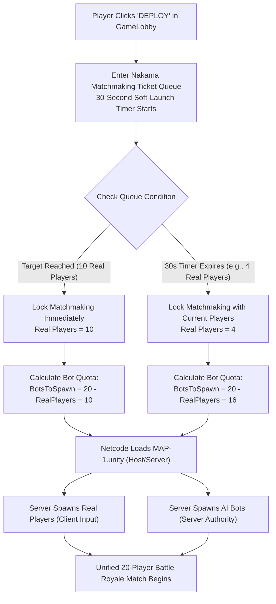

# Railbound: Hybrid Battle Royale Match Loop Architecture & Implementation Plan
**Document Version:** 1.0  
**Target Environment:** Unity 2022.3 LTS | Unity Netcode for GameObjects (NGO) | Nakama 3.x | Reach UI | JUTPS  
**Status:** Saved for Future Implementation  

---

## 1. Executive Summary & Design Vision

Railbound's core Battle Royale mode is engineered for **fast-paced, high-intensity tactical combat** centered around the **Iron Valley Freight Depot** (`MAP-1.unity`).

| Metric | Specification |
| :--- | :--- |
| **Arena Dimensions** | 600m × 600m active playable zone (enclosed by perimeter mountain cliffs) |
| **Total Match Capacity** | **20 Combatants** (Optimized for 600m map density) |
| **Player Composition** | **Hybrid Lobby:** Approximately **10 Real Players** + **Dynamic AI Bot Backfill** |
| **Target Match Duration**| **10 to 12 minutes** (Fast pacing, zero dead time) |
| **Unique Gameplay Hook** | Inbound Perimeter Freight Train infiltration, active rail corridors, Train Heist mid-game airdrops |
| **UI Integration** | Seamless Reach Sci-Fi UI for HUD (Alive counter, storm timer, killfeed, victory banner, pause menu) |

---

## 2. Real-World Commercial Hybrid Lobby Pattern

In modern Battle Royale games (Fortnite, PUBG, CoD Warzone Mobile, Free Fire), hybrid matchmaking ensures players never wait in long queues while preserving intense competitive pressure.



### 2.1 The Dynamic Fill & Timeout Pattern
- **Lobby Quota Formula:**
  $$\text{BotsToSpawn} = \max(0,\, 20 - \text{RealPlayersCount})$$
- **Soft Launch Window (30 seconds):** If the server fills with 10 real players within 15 seconds, it launches instantly. If only 3–6 real players queue during quiet hours, the 30-second countdown guarantees the match starts anyway by backfilling remaining slots with intelligent AI bots.

### 2.2 Bot Disguise & Competitive Immersion
- **Human-like Gamertags:** Bots do NOT display `[BOT]` tags. They are assigned names from a randomized database of realistic player handles (`Ghost_X9`, `ViperRunner`, `KevlarSniper`, `DeltaApex42`, `IronValkyrie`).
- **Randomized Cosmetics:** Bots instantiate with randomized character skins, armor models, and weapon camos.
- **Unified Telemetry:** In the Reach UI Alive Counter, Minimap, and Killfeed, bots and real players appear completely identical.

### 2.3 Dynamic Difficulty Adjustment (DDA)
- **Early Rings (Phases 1–2):** Bots engage at medium range with realistic reaction delays (0.5s–0.8s), giving players early-game confidence, gunplay feedback, and loot upgrades.
- **Late Rings (Phases 3–5):** Surviving bots switch to high-aggression tactical mode: utilizing cover, lobbing grenades, and flanking firing vectors to maintain end-game stakes.

---

## 3. Netcode & Authority Architecture

```
                       ┌──────────────────────────────────────────────┐
                       │          DEDICATED SERVER / HOST             │
                       │         (Authoritative Simulation)           │
                       └──────────────────────┬───────────────────────┘
                                              │
                    ┌─────────────────────────┴────────────────────────┐
                    ▼                                                  ▼
      ┌───────────────────────────┐                      ┌───────────────────────────┐
      │     REAL HUMAN PLAYER     │                      │          AI BOT           │
      │  • NetworkObject          │                      │  • NetworkObject          │
      │  • IsOwner == true        │                      │  • IsOwner == false       │
      │  • JUInputManager: Active │                      │  • Owned by Server        │
      │  • ClientNetworkTransform │                      │  • JUCharacterAIBrain     │
      │    replicates to server   │                      │  • NavMesh Pathfinding    │
      └───────────────────────────┘                      │  • Replicates to clients  │
                                                         └───────────────────────────┘
```

1. **Real Players:**
   - Instantiated with `JUNetworkPlayer.cs` and client ownership.
   - The local client executes inputs (`JUInputManager`), driving the local character.
   - `ClientNetworkTransform` and `ClientNetworkAnimator` broadcast state to the server and all other peers.
2. **AI Bots:**
   - Spawned by `BRBotSpawner.cs` strictly on the Server/Host (`if (!IsServer) return;`).
   - Server runs `JUCharacterArtificialInteligenceBrain` / `JUCharacterRLAgent` + NavMesh Agent.
   - Position and animation replicate through Netcode identically to human players.
   - Remote clients treat bots as standard network puppets.

---

## 4. End-to-End Match Loop (6 Phased Sequence)

```
[Phase 0: Main Menu / GameLobby]
   │  • Player selects loadout & clicks DEPLOY
   ▼
[Phase 1: Dynamic Matchmaking Queue (0s - 30s)]
   │  • Nakama ticket pool collects ~10 real players
   │  • Timeout locks lobby -> Server calculates bot quota
   ▼
[Phase 2: Infiltration & Insertion (30s staging)]
   │  • Players arrive via Inbound Perimeter Freight Train or High-Altitude Drop Pods
   │  • Server instantiates AI bots at outer POIs (Quarry, Motor Pool, Silos)
   │  • 10s countdown on Reach HUD
   ▼
[Phase 3: Scavenge & Contracts (0 - 3 min | Storm: 300m -> 200m)]
   │  • Scavenge Tier 1-3 weapons (P226, UMP5, Benelli Shotgun, Armor)
   │  • Early bot encounters (free kills, builds initial loadout)
   │  • Optional contracts: Radar Recon & Bounty Hunt
   ▼
[Phase 4: Mid-Game Train Heist & Rotations (3 - 8 min | Storm: 200m -> 60m)]
   │  • Dynamic Armored Supply Train pulls into Depot Track 2 (Airdrop Crate)
   │  • Vehicle rotations (Motorcycles & Cars along the outer highway)
   │  • Eliminated players enter Spectator Mode or return to lobby
   ▼
[Phase 5: End-Game Depot Showdown (8 - 11 min | Storm: 60m -> 0m)]
   │  • Final 3-5 survivors trapped in Central Depot Warehouse & Catwalks
   │  • Lethal storm damage (10-15 HP/s) forces final CQB confrontation
   ▼
[Phase 6: Victory & Post-Match Loop]
   │  • Slow-motion cinematic camera on last survivor
   │  • Reach UI Victory Banner: "VICTORY ROYALE - CONVOY SECURED"
   │  • Match Dossier breakdown (Kills, Damage, Survival Time, XP)
   │  • Leaderboard and stats uploaded to Nakama backend
   ▼
[Return to GameLobby / Play Again]
```

### Detailed Phase Breakdown

#### Phase 1: Lobby & Dynamic Matchmaking (0s – 30s)
- **Scene:** `Assets/Project/GameLobby.unity`
- **Controller:** `LobbyMatchmakingController.cs`
- Player enters the matchmaking ticket pool. The system sets a 30s timer.
- If 10 players arrive early &rarr; launch immediately.
- If timer expires with $N$ players &rarr; launch with $N$ real players and set $\text{BotQuota} = 20 - N$.

#### Phase 2: Infiltration & Insertion (30s staging)
- **Scene:** `Assets/Project/MAP-1.unity`
- Real players spawn on the moving **Perimeter Freight Train** or drop from altitude.
- The server spawns the AI bot quota distributed across 4 outer POIs:
  1. Sunken Quarry & Derailed Train (`-150, -2, 130`)
  2. Motor Pool & Garages (`120, 5, 120`)
  3. South Valley Bridge & Overpass (`0, 10, -180`)
  4. West Silos & Refuel Depot (`-160, 0, -60`)
- Reach UI displays a 10-second HUD pre-match countdown timer.

#### Phase 3: Scavenge & Contracts (0:00 – 3:00)
- **Storm:** Initial radius 300m, shrinks to 200m over 45s (Damage: 1.5 HP/s).
- Players loot crates and ground spawns:
  - *Tier 1 (Outer Camps):* P226 handguns, ammo boxes, bandages.
  - *Tier 2 (Garages & Sheds):* UMP5 SMG, Benelli Shotgun, light body armor.
  - *Tier 3 (Terminal HQ & Radar Outpost):* Sniper M82, heavy armor.
- **Contracts:**
  - *Radar Recon:* Capture North Radar station terminal to reveal all enemy positions for 30 seconds.
  - *Bounty Hunt:* Marks a random high-value target (bot or player) with a golden navigation ping.

#### Phase 4: Mid-Game Train Heist & Rotations (3:00 – 8:00)
- **Storm:** Phase 2 (200m &rarr; 120m) & Phase 3 (120m &rarr; 60m) centering around Central Depot.
- **Dynamic Event — The Freight Heist:**
  - An armored train horn echoes across the canyon as locomotive pulls onto Depot Siding Track 2.
  - Carrying high-tier Golden Airdrop Crates (Rocket Launcher, Gold Sniper, Adrenaline Injections).
- **Vehicles:** Motorcycles and Cars parked at the Motor Pool enable rapid rotation into the Depot basin.
- **Eliminations & Spectating:**
  - On human death, camera smoothly detaches and follows the player who eliminated them.
  - Screen displays match placement (`#12 of 20`) with options to spectate or exit.

#### Phase 5: End-Game Depot Showdown (8:00 – 11:00)
- **Storm:** Phase 4 (60m &rarr; 25m) & Phase 5 (25m &rarr; 0m collapse).
- Damage escalates to **10–15 HP/s**, making exposure outside fatal within seconds.
- Final ring centers on the Central Freight Terminal warehouse, container fortresses, and rail wagons.
- Surviving bots and humans engage in multi-level CQB across train roofs, stairs, and catwalks.

#### Phase 6: Victory & Post-Match Loop
- Condition: `AliveCount == 1`.
- **Celebration Sequence:**
  - `Time.timeScale` transitions to 0.3x slow-motion (`JUSlowmotion`).
  - Orbiting victory camera focuses on the winning character.
  - Reach UI displays the animated **"VICTORY ROYALE — CONVOY SECURED"** modal.
- **Post-Match Telemetry Dossier:**
  - Kills, Damage Dealt, Damage Taken, Headshot %, Survival Duration.
  - Credits and Player Profile XP awarded.
  - Asynchronously submitted to Nakama Leaderboards via `AuthenticationService.Instance.Client.WriteLeaderboardRecordAsync`.
- User can click `[PLAY AGAIN]` or `[RETURN TO LOBBY]`.

---

## 5. Technical Component Blueprints

### Component 1: `BRMatchCoordinator.cs`
**File:** `Assets/Project/Scripts/BR/BRMatchCoordinator.cs`  
**Purpose:** Master server-authoritative state machine managing match lifecycle, alive counter, and win conditions.

```csharp
namespace Railbound.BR
{
    public enum BRMatchState
    {
        WaitingForPlayers = 0,
        WarmupCountdown = 1,
        Infiltration = 2,
        ActiveBattle = 3,
        FinalShowdown = 4,
        MatchEnded = 5
    }

    public class BRMatchCoordinator : NetworkBehaviour
    {
        public static BRMatchCoordinator Instance { get; private set; }

        public NetworkVariable<BRMatchState> CurrentState = new NetworkVariable<BRMatchState>(BRMatchState.WaitingForPlayers);
        public NetworkVariable<int> AliveCount = new NetworkVariable<int>(20);
        public NetworkVariable<ulong> WinnerClientId = new NetworkVariable<ulong>(0);

        [SerializeField] private int targetLobbyCapacity = 20;
        [SerializeField] private float warmupDuration = 10f;

        public event Action<int> OnAliveCountChanged;
        public event Action<string, string> OnKillOccurred; // killer, victim

        // Server-side death hook triggered from JUHealth
        public void RegisterElimination(ulong victimClientId, string victimName, string killerName)
        {
            if (!IsServer) return;

            AliveCount.Value = Mathf.Max(0, AliveCount.Value - 1);
            BroadcastKillClientRpc(killerName, victimName);

            if (AliveCount.Value <= 1 && CurrentState.Value == BRMatchState.ActiveBattle)
            {
                TriggerMatchEnd();
            }
        }
    }
}
```

---

### Component 2: `BRBotSpawner.cs`
**File:** `Assets/Project/Scripts/BR/BRBotSpawner.cs`  
**Purpose:** Calculates bot quota, instantiates disguised AI bots on the server, and distributes them across POIs.

```csharp
namespace Railbound.BR
{
    public class BRBotSpawner : NetworkBehaviour
    {
        [SerializeField] private GameObject botPrefab;
        [SerializeField] private Transform[] poiSpawnPoints;
        [SerializeField] private string[] realisticGamertags = new string[]
        {
            "ShadowViper", "IronClad_X", "KryptonSniper", "DeltaRunner",
            "ApexPhantom", "ReconHawk", "Vanguard_99", "EchoSlayer",
            "CanyonWolf", "TitanRider", "NomadZero", "GhostOperator"
        };

        public void SpawnBotBackfill(int targetCapacity)
        {
            if (!IsServer) return;

            int humanCount = NetworkManager.Singleton.ConnectedClients.Count;
            int botsToSpawn = Mathf.Max(0, targetCapacity - humanCount);

            Debug.Log($"[BRBotSpawner] Connected humans: {humanCount}. Spawning {botsToSpawn} AI bots.");

            for (int i = 0; i < botsToSpawn; i++)
            {
                Transform spawnPt = poiSpawnPoints[i % poiSpawnPoints.Length];
                Vector3 spawnPos = spawnPt.position + UnityEngine.Random.insideUnitSphere * 4f;
                spawnPos.y = spawnPt.position.y;

                GameObject botInstance = Instantiate(botPrefab, spawnPos, spawnPt.rotation);
                
                // Assign disguised identity
                string botName = realisticGamertags[UnityEngine.Random.Range(0, realisticGamertags.Length)] + "_" + UnityEngine.Random.Range(10, 99);
                botInstance.name = $"Player_{botName}";

                // Server-authoritative spawn
                var netObj = botInstance.GetComponent<NetworkObject>();
                if (netObj != null)
                {
                    netObj.Spawn(destroyWithScene: true);
                }
            }
        }
    }
}
```

---

### Component 3: `BRMatchHUD.cs`
**File:** `Assets/Project/Scripts/BR/BRMatchHUD.cs`  
**Purpose:** Binds Reach UI components to Netcode state for alive counter, storm timer, killfeed, and victory modal.

```csharp
namespace Railbound.BR
{
    public class BRMatchHUD : MonoBehaviour
    {
        [Header("Reach UI Elements")]
        [SerializeField] private TextMeshProUGUI aliveCountText;
        [SerializeField] private TextMeshProUGUI localKillsText;
        [SerializeField] private TextMeshProUGUI stormTimerText;
        [SerializeField] private GameObject killfeedContainer;
        [SerializeField] private GameObject killfeedEntryPrefab;
        [SerializeField] private GameObject victoryModalPanel;
        [SerializeField] private GameObject defeatModalPanel;

        private int localKills = 0;

        private void Start()
        {
            if (BRMatchCoordinator.Instance != null)
            {
                BRMatchCoordinator.Instance.AliveCount.OnValueChanged += UpdateAliveDisplay;
                BRMatchCoordinator.Instance.OnKillOccurred += AddKillfeedEntry;
            }
        }

        public void RegisterLocalKill()
        {
            localKills++;
            if (localKillsText != null) localKillsText.text = $"KILLS: {localKills}";
        }

        public void ShowVictoryScreen(int finalKills, float survivalTime)
        {
            if (victoryModalPanel != null) victoryModalPanel.SetActive(true);
            Cursor.lockState = CursorLockMode.None;
            Cursor.visible = true;
        }
    }
}
```

---

## 6. Phased Future Execution Roadmap

When ready to proceed with implementation, execute across these 4 phases:

```
┌────────────────────────────────────────────────────────────────────────┐
│ PHASE 1: CORE MATCH COORDINATOR & BOT BACKFILL                         │
│ • Create BRMatchCoordinator.cs & BRBotSpawner.cs                       │
│ • Place 12 POI spawn nodes in MAP-1.unity                              │
│ • Test dynamic bot instantiation based on human player count           │
└───────────────────────────────────┬────────────────────────────────────┘
                                    │
┌───────────────────────────────────▼────────────────────────────────────┐
│ PHASE 2: REACH UI MATCH HUD & KILLFEED INTEGRATION                     │
│ • Build BRMatchHUD.cs hooked to Reach UI elements                      │
│ • Implement Alive Counter (ALIVE: XX / 20) & Storm Countdown Timer     │
│ • Implement animated Killfeed using Reach notification styling         │
└───────────────────────────────────┬────────────────────────────────────┘
                                    │
┌───────────────────────────────────▼────────────────────────────────────┐
│ PHASE 3: ELIMINATION, SPECTATOR MODE & VICTORY SEQUENCE                │
│ • Hook JUHealth.OnDeath to decrement AliveCount and trigger killfeed   │
│ • Create Spectator Camera tracking killer on player death              │
│ • Implement slow-motion victory celebration and Victory Modal          │
└───────────────────────────────────┬────────────────────────────────────┘
                                    │
┌───────────────────────────────────▼────────────────────────────────────┐
│ PHASE 4: NAKAMA MATCHMAKING QUEUE & POST-MATCH SYNC                    │
│ • Upgrade LobbyMatchmakingController.cs with 30s queue countdown       │
│ • Implement post-match telemetry submission to Nakama Leaderboards     │
│ • Test end-to-end match loop from GameLobby -> MAP-1 -> GameLobby     │
└────────────────────────────────────────────────────────────────────────┘
```

---
*Plan created and verified for Railbound. Stored permanently for execution.*
