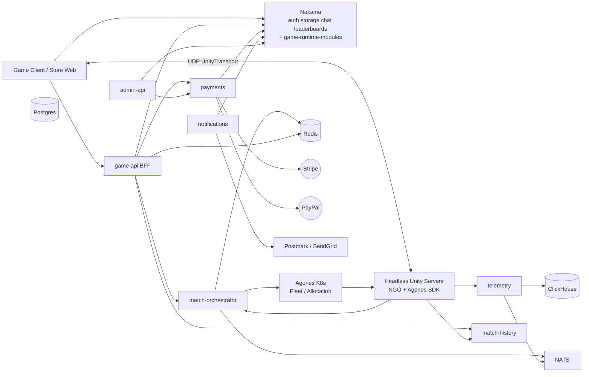
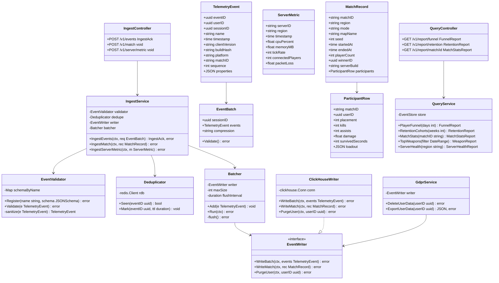
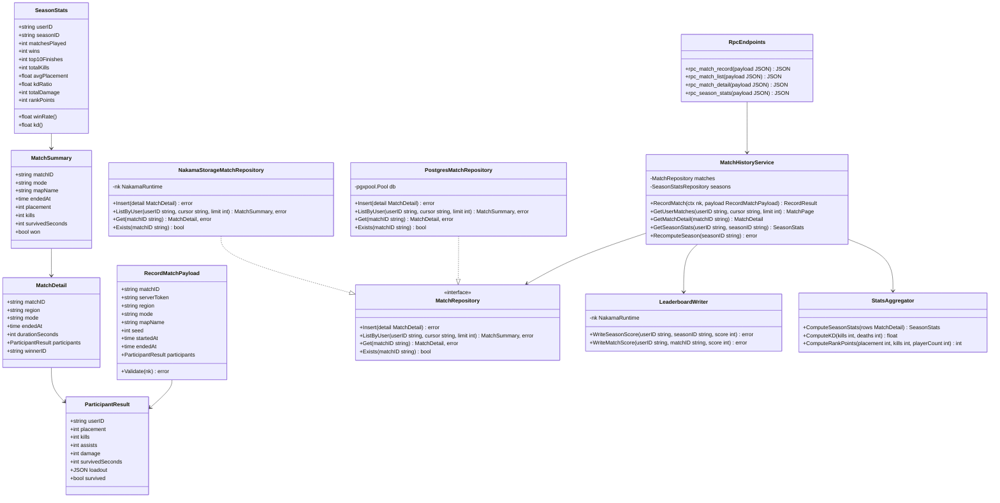
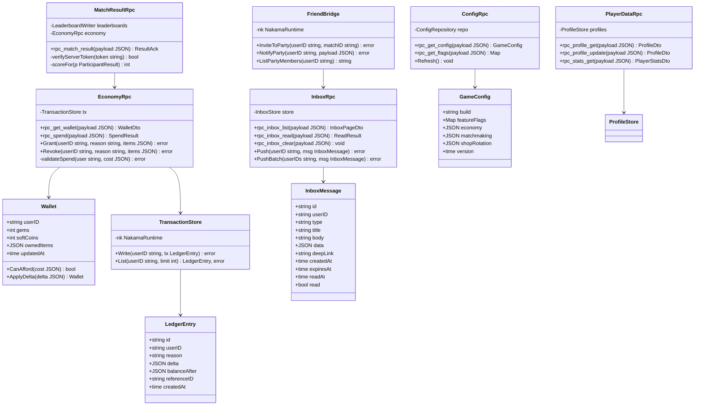
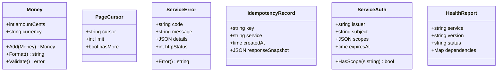

# Railbound — Microservices: Class Diagrams & Tech Stack

**Stack decision:** F2P PC · Stripe/PayPal web payments · NGO headless servers on Agones/K8s · Nakama backend.

## What you build (7 services + 2 code deployables)

| # | Service | Tier |
|---|---------|------|
| 1 | `match-orchestrator` | microservice |
| 2 | `payments` | microservice |
| 3 | `game-api` (BFF) | microservice |
| 4 | `telemetry` | microservice |
| 5 | `notifications` | microservice (email — PC has no APNs/FCM) |
| 6 | `admin-api` | microservice |
| 7 | `match-history` | Nakama TS module → promote to service later |
| A | `game-runtime-modules` | code running **inside** Nakama (economy, inbox, config, results) |
| B | `admin-ui` + `store-web` | React front-ends |

**Do NOT build:** auth, chat, friends, groups, presence, storage, leaderboards, sessions, card processing (Stripe/PayPal hosted).

---

## Tech stack (per service)

| Service | Language / Framework | Data store | Queue | Key libs / reason |
|---|---|---|---|---|
| `match-orchestrator` | **Go 1.22** + chi (HTTP) + gRPC | **Redis 7** (tickets/queues) + **Postgres 16** (match registry) | **NATS JetStream** | Agones Go SDK, `client-go`, `google/uuid`, `golang-jwt` — allocation loop must be fast & close to K8s API |
| `payments` | **TypeScript + NestJS 10** + Prisma | **Postgres 16** (own DB — financial) | BullMQ (Redis) | `stripe`, `@paypal/paypal-server-sdk`, idempotency via DB unique keys |
| `game-api` | **TypeScript + NestJS 10** | Redis (response cache) | — | shares TS with payments; typed HTTP clients + retries |
| `telemetry` | **Go** + `clickhouse-go` | **ClickHouse** | NATS JetStream (ingest buffer) | columnar analytics, batch inserts, low memory at high event volume |
| `notifications` | **TypeScript + NestJS 10** + BullMQ | Postgres 16 + Redis | BullMQ | `postmark` / `@sendgrid/mail`, template rendering, retries/backoff |
| `admin-api` | **TypeScript + NestJS 10** | Postgres 16 (audit, tickets) | — | RBAC middleware; calls Nakama Console REST |
| `match-history` (phase A) | **TypeScript** Nakama runtime module | Nakama Postgres (storage/leaderboard) | — | ships with the runtime; zero extra infra |
| `match-history` (phase B) | Go or TS/NestJS | Postgres 16 | — | when query volume grows |
| `game-runtime-modules` | **TypeScript** (Nakama TS runtime) | Nakama storage / leaderboards | — | economy, inbox, config, match-result RPCs |
| `admin-ui` | **React 18 + Vite + TS** + TanStack Query + Ant Design | — | — | internal tool |
| `store-web` | **React 18 + Vite + TS** | — | — | store page + Stripe/PayPal return URL |

**Shared infra:** Kubernetes + **Agones**, NGINX Ingress + cert-manager, External Secrets, PostgreSQL Operator, Redis, NATS, Prometheus/Grafana/Loki + OpenTelemetry, GitHub Actions → ArgoCD, GHCR/ECR.

---

## 0. System context

---

## 1. `match-orchestrator` (Go)

```mermaid
classDiagram
    direction TB

    class OrchestratorConfig {
        +string tokenSecret
        +duration joinTokenTTL
        +duration ticketTTL
        +duration reconcileInterval
        +RegionConfig regions
        +int skillBucketWidth
        +int maxPartySize
        +Load() error
    }

    class RegionConfig {
        +string code
        +string fleetName
        +string k8sNamespace
        +int minReady
        +int maxReplicas
        +int gamePort
        +string nodeSelector
    }

    class MatchOrchestrator {
        -TicketStore tickets
        -MatchQueue queue
        -FleetManager fleets
        -TokenIssuer tokens
        -EventBus events
        -OrchestratorConfig cfg
        +FindMatch(ctx FindContext, req FindMatchRequest) Ticket, error
        +GetTicket(ctx, ticketID uuid) Ticket, error
        +CancelTicket(ctx, ticketID uuid, userID uuid) error
        +ReconcileLoop(ctx) error
        +HandleMatchEnd(ctx, EndMatchRequest) MatchResult, error
        +HandleServerCrash(ctx, GameServerRef) error
        -allocateFor(ctx, tickets Ticket) error
        -matchWithinBucket(ctx, bucket QueueBucket) Pair, error
        -scaleFleets(ctx) error
        -expireOldTickets(ctx) error
    }

    class FindMatchRequest {
        +uuid userID
        +string region
        +string mode
        +int mmr
        +uuid partyMembers
        +string clientVersion
        +Validate() error
    }

    class Ticket {
        +uuid id
        +uuid userID
        +string region
        +string mode
        +int mmr
        +TicketState state
        +string matchID
        +GameServerRef server
        +time createdAt
        +time expiresAt
        +IsExpired() bool
        +CanAllocate() bool
        +BucketKey(width int) string
    }

    class TicketState {
        <<enum>>
        Queued
        Allocating
        Ready
        InMatch
        Cancelled
        Expired
    }

    class TicketStore {
        <<interface>>
        +Create(t Ticket) error
        +Get(id uuid) Ticket, error
        +Update(t Ticket) error
        +Delete(id uuid) error
        +ListByState(s TicketState) Ticket, error
    }

    class RedisTicketStore {
        -redis.Client rdb
        +Create(t Ticket) error
        +Get(id uuid) Ticket, error
        +Update(t Ticket) error
        +Delete(id uuid) error
        +ListByState(s TicketState) Ticket, error
    }

    class MatchQueue {
        -redis.Client rdb
        +Enqueue(t Ticket) error
        +PeekBucket(bucketKey string) Ticket, error
        +Remove(t Ticket) error
        +Length(bucketKey string) int, error
        +QueueDepth() map, error
    }

    class FleetManager {
        <<interface>>
        +AllocateReady(ctx, region string, mode string) GameServerRef, error
        +Get(ctx, name string) GameServerRef, error
        +Release(ctx, ref GameServerRef) error
        +Scale(ctx, region string, ready int, max int) error
        +Status(ctx) FleetStatus, error
    }

    class AgonesFleetManager {
        -agones clientset.Clientset agones
        -kubernetes clientset.Interface kube
        -OrchestratorConfig cfg
        +AllocateReady(ctx, region string, mode string) GameServerRef, error
        +Get(ctx, name string) GameServerRef, error
        +Release(ctx, ref GameServerRef) error
        +Scale(ctx, region string, ready int, max int) error
        +Status(ctx) FleetStatus, error
    }

    class GameServerRef {
        +string name
        +string k8sNamespace
        +string address
        +int port
        +string region
        +string mode
        +GSState state
        +time allocatedAt
        +string matchID
        +Addresses() string
    }

    class GSState {
        <<enum>>
        Ready
        Allocated
        Shutdown
        Unhealthy
    }

    class TokenIssuer {
        -[]byte secret
        -duration ttl
        +Issue(userID uuid, matchID string, ref GameServerRef) string, error
        +Validate(token string) JoinClaims, error
    }

    class JoinClaims {
        +uuid userID
        +string matchID
        +string address
        +int port
        +string nonce
        +time expiresAt
        +Verify() error
    }

    class EndMatchRequest {
        +string matchID
        +string serviceToken
        +MatchResult result
        +Validate() error
    }

    class MatchResult {
        +string matchID
        +string region
        +string mode
        +string mapName
        +int seed
        +time startedAt
        +time endedAt
        +int playerCount
        +uuid winnerID
        +Participant results
    }

    class Participant {
        +uuid userID
        +int placement
        +int kills
        +float damage
        +int survivedSeconds
        +JSON loadout
    }

    class EventBus {
        <<interface>>
        +PublishMatchEnded(ctx, MatchResult) error
        +PublishAllocationFailed(ctx, error) error
    }

    class NATSEventBus {
        -nats.Conn conn
        +PublishMatchEnded(ctx, MatchResult) error
        +PublishAllocationFailed(ctx, error) error
    }

    class TicketController {
        +POST /v1/ticket FindMatchRequest
        +GET /v1/ticket/id Ticket
        +DELETE /v1/ticket/id CancelResponse
    }

    class InternalMatchController {
        +POST /v1/internal/match/end EndMatchRequest
        +POST /v1/internal/server/crash CrashReport
        +GET /v1/internal/fleet/status FleetStatus
    }

    MatchOrchestrator --> TicketStore : uses
    MatchOrchestrator --> MatchQueue : uses
    MatchOrchestrator --> FleetManager : uses
    MatchOrchestrator --> TokenIssuer : uses
    MatchOrchestrator --> EventBus : publishes
    RedisTicketStore ..|> TicketStore
    AgonesFleetManager ..|> FleetManager
    NATSEventBus ..|> EventBus
    Ticket --> TicketState
    Ticket --> GameServerRef
    AgonesFleetManager --> GameServerRef : produces
    TokenIssuer --> JoinClaims
    TicketController --> MatchOrchestrator
    InternalMatchController --> MatchOrchestrator
    OrchestratorConfig --> RegionConfig
    MatchEndRequest --> MatchResult
    MatchResult --> Participant
```

---

## 2. `payments` (TypeScript / NestJS)

```mermaid
classDiagram
    direction TB

    class CheckoutService {
        -CatalogService catalog
        -ProviderRouter providers
        -LedgerRepository ledger
        -FulfillmentPort fulfillment
        +CreateCheckout(userID uuid, skuCode string, provider Provider) CheckoutSession
        +HandleStripeEvent(evt JSON) void
        +HandlePayPalEvent(evt JSON) void
        +Refund(txID uuid, reason string) RefundResult
        -settle(tx PaymentTransaction, evt EventRecord) void
        -reverse(tx PaymentTransaction, evt EventRecord) void
    }

    class CheckoutSession {
        +uuid id
        +uuid userID
        +string skuCode
        +Provider provider
        +string providerRef
        +int amountCents
        +string currency
        +SessionStatus status
        +time createdAt
        +time expiresAt
        +JSON metadata
    }

    class SessionStatus {
        <<enum>>
        Created
        Pending
        Paid
        Failed
        Expired
        Refunded
    }

    class Provider {
        <<enum>>
        Stripe
        PayPal
    }

    class Sku {
        +string code
        +string title
        +string description
        +int priceCents
        +string currency
        +int gemAmount
        +int bonusGems
        +JSON grantItems
        +bool active
        +JSON providerRefs
    }

    class PaymentTransaction {
        <<ledger row - immutable>>
        +uuid id
        +uuid userID
        +string skuCode
        +Provider provider
        +string providerTxID
        +TxType type
        +int amountCents
        +string currency
        +TxStatus status
        +string idempotencyKey
        +string webhookEventID
        +time createdAt
        +time settledAt
        +JSON rawPayload
    }

    class TxType {
        <<enum>>
        Payment
        Refund
        Chargeback
    }

    class TxStatus {
        <<enum>>
        Pending
        Settled
        Refunded
        Disputed
        Reversed
    }

    class Fulfillment {
        +uuid id
        +uuid transactionID
        +uuid userID
        +GrantStatus status
        +JSON grantedItems
        +string nakamaWriteRef
        +int attempts
        +time grantedAt
        +string lastError
    }

    class GrantStatus {
        <<enum>>
        Pending
        Granted
        Revoked
        Failed
    }

    class PaymentProvider {
        <<interface>>
        +CreateCheckout(session CheckoutSession) ProviderRedirect, error
        +Refund(providerTxID string, amountCents int) ProviderRefund, error
        +ParseWebhook(headers Map, body bytes) ProviderEvent, error
    }

    class StripeProvider {
        -stripe.Client api
        -string webhookSecret
        +CreateCheckout(session CheckoutSession) ProviderRedirect, error
        +Refund(providerTxID string, amountCents int) ProviderRefund, error
        +ParseWebhook(headers Map, body bytes) ProviderEvent, error
    }

    class PayPalProvider {
        -paypal.OrdersApi api
        -string webhookID
        -string certURLCache
        +CreateCheckout(session CheckoutSession) ProviderRedirect, error
        +Refund(providerTxID string, amountCents int) ProviderRefund, error
        +ParseWebhook(headers Map, body bytes) ProviderEvent, error
    }

    class ProviderRouter {
        -Map providers
        +Get(p Provider) PaymentProvider
        +Register(p Provider, impl PaymentProvider) void
    }

    class FulfillmentPort {
        <<interface>>
        +Grant(userID uuid, sku Sku, tx PaymentTransaction) GrantResult, error
        +Revoke(userID uuid, tx PaymentTransaction) error
    }

    class NakamaFulfillmentAdapter {
        -string nakamaURL
        -string serverKey
        -HTTPClient http
        +Grant(userID uuid, sku Sku, tx PaymentTransaction) GrantResult, error
        +Revoke(userID uuid, tx PaymentTransaction) error
        -storageWrite(userID uuid, key string, value JSON) error
    }

    class CatalogService {
        -LedgerRepository repo
        +ListActive() Sku, error
        +GetByCode(code string) Sku, error
        +Upsert(s Sku) error
    }

    class IdempotencyGuard {
        -LedgerRepository repo
        +Begin(key string, evt EventRecord) bool
        +Complete(key string) void
    }

    class LedgerRepository {
        -pgxpool.Pool db
        +InsertPending(tx PaymentTransaction) error
        +Settle(providerTxID string, evt EventRecord) PaymentTransaction, error
        +MarkRefunded(providerTxID string) PaymentTransaction, error
        +FindByProviderTx(id string) PaymentTransaction, error
        +InsertFulfillment(f Fulfillment) error
        +PendingFulfillments(limit int) Fulfillment, error
    }

    class WebhookRetryWorker {
        -LedgerRepository repo
        -FulfillmentPort fulfillment
        -duration backoff
        +Run(ctx) error
        -attempt(f Fulfillment) error
    }

    class CheckoutController {
        +POST /v1/checkout CheckoutRedirect
        +GET /v1/sku StoreItem
        +GET /v1/sku StoreItem
    }

    class WebhookController {
        +POST /webhook/stripe void
        +POST /webhook/paypal void
    }

    CheckoutService --> ProviderRouter
    CheckoutService --> FulfillmentPort
    CheckoutService --> LedgerRepository
    CheckoutService --> CatalogService
    StripeProvider ..|> PaymentProvider
    PayPalProvider ..|> PaymentProvider
    NakamaFulfillmentAdapter ..|> FulfillmentPort
    IdempotencyGuard --> LedgerRepository
    WebhookRetryWorker --> LedgerRepository
    WebhookRetryWorker --> FulfillmentPort
    CheckoutController --> CheckoutService
    WebhookController --> CheckoutService
    CheckoutSession --> Sku
    PaymentTransaction --> TxType
    PaymentTransaction --> TxStatus
    Fulfillment --> GrantStatus
```

---

## 3. `game-api` (BFF, TypeScript / NestJS)

```mermaid
classDiagram
    direction TB

    class AuthMiddleware {
        -NakamaTokenValidator validator
        -RateLimiter rateLimiter
        +Use(req, res, next) void
    }

    class NakamaTokenValidator {
        -string nakamaURL
        -string serverKey
        -Cache cache
        +Validate(bearer string) Claims, error
        -localVerify(jwt string) Claims, error
        -remoteVerify(token string) Claims, error
    }

    class Claims {
        +uuid userID
        +string username
        +time expiresAt
        +bool expired()
    }

    class ProfileService {
        -NakamaRestClient nakama
        -MatchHistoryClient history
        +GetProfile(userID uuid) ProfileDto
        +UpdateProfile(userID uuid, req UpdateProfileRequest) ProfileDto
        +GetInventory(userID uuid) ItemDto
    }

    class StoreService {
        -PaymentsClient payments
        -NakamaRestClient nakama
        +ListItems(userID uuid) StoreItemDto
        +StartPurchase(userID uuid, skuCode string, provider string) CheckoutRedirect
        +GetPurchaseStatus(userID uuid, sessionID string) PurchaseStatusDto
    }

    class MatchService {
        -OrchestratorClient orchestrator
        +FindMatch(userID uuid, req FindMatchRequest) TicketDto
        +GetTicket(userID uuid, ticketID string) TicketDto
        +Cancel(userID uuid, ticketID string) void
        +GetMatchResult(userID uuid, matchID string) MatchResultDto
    }

    class LeaderboardService {
        -NakamaRestClient nakama
        +GetLeaderboard(id string, limit int) LeaderboardEntryDto
        +GetUserRank(id string, userID uuid) LeaderboardEntryDto
    }

    class NotificationService {
        -NakamaRestClient nakama
        +ListInbox(userID uuid, cursor string) InboxPageDto
        +MarkRead(userID uuid, ids string) void
        +Unsubscribe(token string) void
    }

    class NakamaRestClient {
        -string baseURL
        -string serverKey
        -HTTPClient http
        -RetryPolicy retry
        +GetAccount(token string) AccountDto
        +StorageRead(token string, collection string) JSON
        +StorageWrite(serverKey string, userID string, objects JSON) error
        +LeaderboardOwnerss(id string, limit int) LeaderboardEntryDto
        +RPC(token string, id string, payload JSON) JSON
    }

    class OrchestratorClient {
        -string baseURL
        -HTTPClient http
        +CreateTicket(userID uuid, req JSON) TicketDto
        +GetTicket(ticketID string) TicketDto
        +CancelTicket(ticketID string, userID uuid) void
    }

    class PaymentsClient {
        -string baseURL
        -string serviceToken
        -HTTPClient http
        +CreateCheckout(userID uuid, sku string, provider string) CheckoutRedirect
        +GetSession(sessionID string) CheckoutSession
        +Refund(txID string, reason string) RefundResult
    }

    class ResponseCache {
        -redis.Client rdb
        +Get(key string) JSON, bool
        +Set(key string, val JSON, ttl duration) void
        +InvalidatePattern(pattern string) void
    }

    class RateLimiter {
        -redis.Client rdb
        +Allow(key string, limit int, window duration) bool
    }

    class ProfileController {
        +GET /v1/profile ProfileDto
        +PATCH /v1/profile ProfileDto
        +GET /v1/inventory ItemDto
    }

    class StoreController {
        +GET /v1/store StoreItemDto
        +POST /v1/purchase CheckoutRedirect
        +GET /v1/purchase/id PurchaseStatusDto
    }

    class MatchController {
        +POST /v1/match/find TicketDto
        +GET /v1/match/ticket/id TicketDto
        +DELETE /v1/match/ticket/id void
    }

    AuthMiddleware --> NakamaTokenValidator
    NakamaTokenValidator --> Claims
    AuthMiddleware --> RateLimiter
    ProfileService --> NakamaRestClient
    StoreService --> PaymentsClient
    StoreService --> NakamaRestClient
    MatchService --> OrchestratorClient
    LeaderboardService --> NakamaRestClient
    NotificationService --> NakamaRestClient
    ProfileController --> ProfileService
    StoreController --> StoreService
    MatchController --> MatchService
    ProfileService --> ResponseCache
```

---

## 4. `telemetry` (Go + ClickHouse)

---

## 5. `notifications` (TypeScript / NestJS + BullMQ)

```mermaid
classDiagram
    direction TB

    class NotificationService {
        -TemplateRegistry templates
        -ChannelRouter channels
        -DeliveryRepository deliveries
        +Send(userID uuid, templateKey string, data JSON) Delivery, error
        +SendTransactional(to string, templateKey string, data JSON) Delivery, error
        +Schedule(req ScheduleRequest) Campaign
        +Cancel(campaignID uuid) error
        +Resend(deliveryID uuid) Delivery, error
    }

    class ChannelRouter {
        -Map channels
        +Route(userID uuid, kind NotifyKind) Channel
        +Register(kind NotifyKind, ch Channel) void
    }

    class NotifyKind {
        <<enum>>
        TransactionalEmail
        MarketingEmail
        IngameInbox
    }

    class Channel {
        <<interface>>
        +Name() string
        +Send(msg OutboundMessage) ChannelResult, error
        +Supports(kind NotifyKind) bool
    }

    class EmailChannel {
        -EmailProvider provider
        -TemplateRenderer renderer
        +Name() string
        +Send(msg OutboundMessage) ChannelResult, error
        +Supports(kind NotifyKind) bool
    }

    class InboxChannel {
        -NakamaRuntimeClient nakama
        +Name() string
        +Send(msg OutboundMessage) ChannelResult, error
        +Supports(kind NotifyKind) bool
    }

    class EmailProvider {
        <<interface>>
        +Send(mail EmailMessage) ProviderResult, error
    }

    class PostmarkProvider {
        -PostmarkClient api
        +Send(mail EmailMessage) ProviderResult, error
    }

    class SendGridProvider {
        -SendGridClient api
        +Send(mail EmailMessage) ProviderResult, error
    }

    class EmailTemplate {
        +string key
        +string locale
        +string subject
        +string htmlBody
        +string textBody
        +JSON paramSchema
        +int version
        +bool active
        +Render(data JSON) RenderedEmail, error
    }

    class TemplateRegistry {
        -Map templates
        +Register(t EmailTemplate) error
        +Get(key string, locale string) EmailTemplate, error
        +Render(key string, locale string, data JSON) RenderedEmail, error
    }

    class Subscriber {
        +uuid userID
        +string email
        +string locale
        +bool marketingOptIn
        +time consentAt
        +string unsubscribeToken
        +time createdAt
    }

    class Delivery {
        +uuid id
        +uuid userID
        +NotifyKind kind
        +string templateKey
        +string recipient
        +DeliveryStatus status
        +int attempts
        +time nextRetryAt
        +string providerMessageID
        +string lastError
        +time createdAt
        +time deliveredAt
    }

    class DeliveryStatus {
        <<enum>>
        Queued
        Sent
        Failed
        Bounced
        Suppressed
    }

    class OutboundMessage {
        +uuid userID
        +string recipient
        +NotifyKind kind
        +RenderedEmail render
        +JSON data
        +string deepLink
    }

    class Campaign {
        +uuid id
        +string name
        +string segmentQuery
        +string templateKey
        +time scheduledAt
        +CampaignStatus status
        +int recipientCount
        +int sentCount
        +int openCount
        +int clickCount
    }

    class CampaignStatus {
        <<enum>>
        Draft
        Scheduled
        Running
        Paused
        Completed
        Cancelled
    }

    class UnsubscribeService {
        -SubscriberRepository repo
        +Resolve(token string) Subscriber
        +OptOut(userID uuid, kind NotifyKind) void
        +OptIn(userID uuid, kind NotifyKind) void
    }

    class NotificationWorker {
        -NotificationService notifications
        -BullMQ.Queue queue
        +Process(job Job) void
        -retryPolicy(attempt int) duration
    }

    class WebhookController {
        +POST /webhook/email/bounce void
        +POST /webhook/email/open void
    }

    NotificationService --> TemplateRegistry
    NotificationService --> ChannelRouter
    NotificationService --> DeliveryRepository
    ChannelRouter --> Channel
    EmailChannel --> EmailProvider
    EmailChannel --> TemplateRegistry
    InboxChannel --> NakamaRuntimeClient
    PostmarkProvider ..|> EmailProvider
    SendGridProvider ..|> EmailProvider
    InboxChannel ..|> Channel
    NotificationWorker --> NotificationService
    EmailChannel --> OutboundMessage
    Delivery --> DeliveryStatus
    Campaign --> CampaignStatus
    UnsubscribeService --> Subscriber
    WebhookController --> DeliveryRepository
```

---

## 6. `admin-api` (TypeScript / NestJS) + `admin-ui`

```mermaid
classDiagram
    direction TB

    class AdminUser {
        +uuid id
        +string email
        +AdminRole role
        +JSON permissions
        +bool mfaEnabled
        +time lastLoginAt
        +time createdAt
        +bool active
        +Can(perm Permission) bool
    }

    class AdminRole {
        <<enum>>
        SuperAdmin
        Finance
        Support
        Analyst
        ReadOnly
    }

    class Permission {
        <<enum>>
        PlayerRead
        PlayerBan
        PlayerGrant
        RefundIssue
        TicketManage
        ConfigEdit
        AuditRead
    }

    class RbacMiddleware {
        -AdminUserRepository admins
        +Use(req, res, next) void
        -requirePermission(p Permission) Handler
    }

    class PlayerAdminService {
        -NakamaConsoleClient nakama
        -PaymentsClient payments
        -AuditLogger audit
        +Search(query string, cursor string) PlayerPageDto
        +GetDetail(userID uuid) PlayerDetailDto
        +Ban(userID uuid, req BanRequest) BanRecord
        +Unban(banID uuid) BanRecord
        +Mute(userID uuid, duration duration) void
        +GrantItems(userID uuid, req GrantRequest) GrantRecord
        +ForceLogout(userID uuid) void
        +GetSessions(userID uuid) SessionDto
    }

    class BanRecord {
        +uuid id
        +uuid userID
        +string reason
        +uuid createdBy
        +time createdAt
        +time expiresAt
        +bool active
        +IsActive() bool
    }

    class GrantRecord {
        +uuid id
        +uuid userID
        +JSON items
        +string reason
        +uuid transactionID
        +uuid createdBy
        +time createdAt
    }

    class FinanceService {
        -PaymentsClient payments
        -AuditLogger audit
        +ListTransactions(filter TxFilter) TransactionPageDto
        +GetTransaction(txID uuid) TransactionDetailDto
        +IssueRefund(txID uuid, reason string) RefundResult
        +GetLedgerSummary(range DateRange) LedgerSummaryDto
    }

    class NakamaConsoleClient {
        -string consoleURL
        -string username
        -string password
        -string sessionToken
        +SearchUsers(q string) AccountDto
        +Ban(userID uuid) error
        +Unban(userID uuid) error
        +DeleteStorage(collection string, key string) error
        +WriteStorage(userID string, objects JSON) error
        -login() error
    }

    class AuditLogger {
        -pgxpool.Pool db
        +Log(entry AuditEntry) error
        +List(filter AuditFilter) AuditEntry, error
    }

    class AuditEntry {
        +uuid id
        +uuid adminUserID
        +string action
        +string targetType
        +string targetID
        +JSON before
        +JSON after
        +string ip
        +time createdAt
    }

    class SupportTicketService {
        -TicketRepository repo
        +Create(req CreateTicketRequest) SupportTicket
        +Reply(ticketID uuid, msg Message) SupportTicket
        +Assign(ticketID uuid, adminID uuid) SupportTicket
        +Close(ticketID uuid, resolution string) SupportTicket
        +List(filter TicketFilter) TicketPageDto
    }

    class SupportTicket {
        +uuid id
        +uuid userID
        +TicketCategory category
        +TicketStatus status
        +uuid assignee
        +Message messages
        +time createdAt
        +time closedAt
        +AddMessage(m Message) void
    }

    class TicketCategory {
        <<enum>>
        Payment
        Gameplay
        Account
        Bug
        Other
    }

    class TicketStatus {
        <<enum>>
        Open
        InProgress
        WaitingOnPlayer
        Closed
    }

    class ConfigService {
        -FeatureFlagRepository flags
        +GetFlags(build string) Map
        +SetFlag(key string, value JSON) error
        +GetEconomyConfig() EconomyConfig
        +SetEconomyConfig(cfg EconomyConfig) error
    }

    class AdminController {
        +GET /v1/players PlayerPageDto
        +POST /v1/players/id/ban BanRecord
        +POST /v1/players/id/grant GrantRecord
        +POST /v1/tx/id/refund RefundResult
        +GET /v1/audit AuditEntry
        +GET /v1/tickets TicketPageDto
        +PUT /v1/config/flags Map
    }

    RbacMiddleware --> AdminUser
    PlayerAdminService --> NakamaConsoleClient
    PlayerAdminService --> AuditLogger
    PlayerAdminService --> PaymentsClient
    FinanceService --> PaymentsClient
    FinanceService --> AuditLogger
    SupportTicketService --> TicketRepository
    ConfigService --> FeatureFlagRepository
    AdminController --> PlayerAdminService
    AdminController --> FinanceService
    AdminController --> SupportTicketService
    AdminController --> ConfigService
    AdminUser --> AdminRole
    BanRecord --> AdminUser
    SupportTicket --> TicketCategory
    SupportTicket --> TicketStatus
```

---

## 7. `match-history` (phase A: Nakama runtime module → phase B: service)

---

## 8. `game-runtime-modules` (TypeScript, runs inside Nakama)

---

## 9. Shared kernel (types reused across services)

**Service-to-service auth:** short-lived HS256 JWTs (`ServiceAuth`) signed with a cluster secret from External Secrets; each service exposes `GET /healthz` + `GET /readyz` returning `HealthReport`.

---

## Verification checklist

- [ ] Every class above maps to **one file/module** in code
- [ ] `payments.PaymentTransaction` and `Fulfillment` states drive your webhook state machine
- [ ] `match-orchestrator.TicketState` is the source of truth for the match lifecycle
- [ ] Build order: **orchestrator → runtime-modules → game-api → payments → telemetry → notifications → admin**
