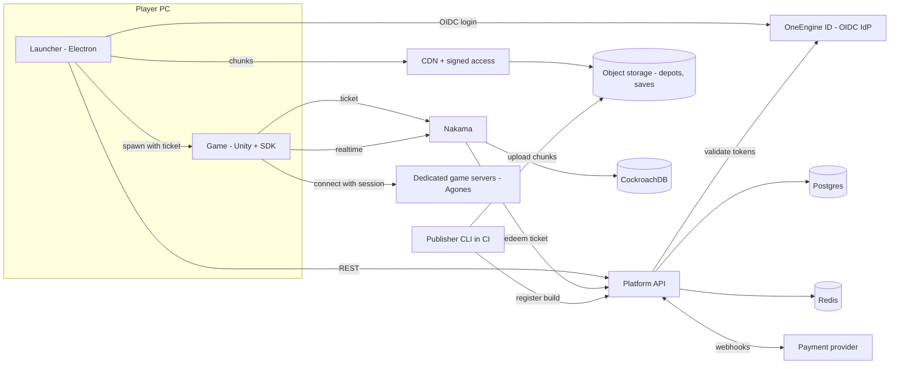
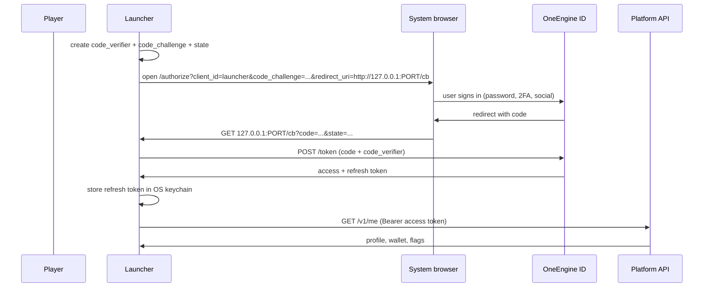
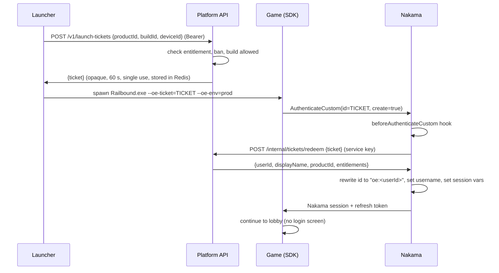
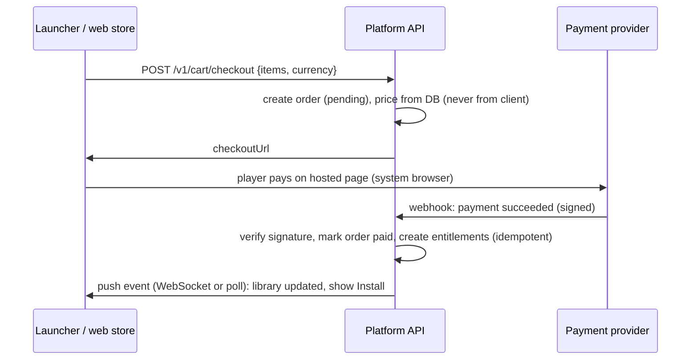

# OneEngine Store: Development Guide

Audience: the developers who will build the OneEngine Store platform and integrate Railbound (and later other games) into it.
Status: v1 plan, written 2026-11-14. Items marked **[VERIFY]** are assumptions or figures that must be checked before they are relied on.

---

## 0. How to read this document

| If you are... | Read |
|---|---|
| Launcher (Electron/React) developer | 1, 2, 4, 5, 9 |
| Backend developer | 1, 2, 3, 4, 6, 7, 8 |
| Unity / game developer | 1, 2, 4, 10 |
| DevOps | 1, 2, 5, 11, 12 |
| Project lead | 1, 2, 13, 14 |

**Glossary**

| Term | Meaning |
|---|---|
| Launcher | The OneEngine Store desktop app (Electron + React). Store, library, downloads, launch. |
| Platform API | New backend service for catalog, library, orders, builds, launch tickets. |
| Nakama | The game backend already running for Railbound (login, matchmaking, parties, chat, storage). |
| IdP | Identity provider: the one place that owns accounts and passwords ("OneEngine ID"). |
| Depot | All files of one product build, stored as content-addressed chunks. |
| Manifest | Signed file that lists the files of a build and the chunks each file is made of. |
| Entitlement | A record that a user owns a product (bought, redeemed, granted, free). |
| Launch ticket | One-time, 60-second token the launcher hands to the game so it can sign in. |
| SDK | The OneEngine Unity package that every game integrates. |

---

## 1. Current state (what exists today)

### 1.1 Store repo (`one_engine_store`)

- Electron main process: `electron/main.cjs`, `electron/preload.cjs`.
- UI: React 19, Vite, Tailwind. Screens: Store, Library, Downloads, Community, Activity, Settings. Design rules are in `DESIGN.md`.
- `src/store/useStore.tsx` (about 990 lines) holds all state. **Games, articles and notifications are hard-coded (`INITIAL_GAMES` and similar). Downloads are a simulation tick.** Nothing is real yet.
- `src/lib/nakama.ts`: logs in to Nakama (email or guest) through an Electron IPC proxy (`nakama-request`).
- Launch: `ipcMain 'launch-game'` spawns the game exe with `--nakama-token`, `--nakama-refresh-token`, `--auth-token`, `--player-name`, `--user-id` on the command line.
- `unity/LauncherAuthReceiver.cs` (in the store repo, **not in the game repo**) parses those arguments and has a "CONTINUE AS GUEST" button.
- Leftovers: `src-tauri/` (second shell, Rust) and `@supabase/supabase-js` (unused).

### 1.2 Game repo (Railbound)

- `AuthenticationService` (Nakama client): email login, device-id guest login, saved-session restore (`SecureSessionStore`). It does **not** read anything from a launcher.
- Nakama server module has one RPC: `railbound_allocate` (game-server allocation through Agones). No hooks, no wallet, no friends.
- Player progress (level, XP, coins) is written to Nakama storage by the client (cheatable). Settings, operator looks and key bindings are local only.
- Infra: k3s on AWS (ap-south-1), Argo CD (GitOps), Terraform, CockroachDB (Nakama's database), Agones fleet, Prometheus/Grafana.

### 1.3 Problems that must be fixed first (blockers)

| # | Problem | Why it matters | Fix |
|---|---|---|---|
| B1 | Nakama chart `values.yaml` in the gitops repo contains placeholder secrets (`defaultencryptionkey`, `defaultsigningkey`, `defaulthttpkey`, server key `defaultkey` used by the client). **[VERIFY whether production overrides them.]** | With a known session encryption key anyone can forge a session token for any user. | Generate real random secrets, store them in Kubernetes secrets (not in git), rotate, redeploy. Do this before any public build. |
| B2 | Session tokens are passed on the command line. | Any process (and any user on the machine) can read them. | Replace with launch tickets (section 4.5). |
| B3 | Electron: `webSecurity: false`, `sandbox: false`, and a generic IPC handler that makes arbitrary HTTP requests for the web page. | A single XSS in the renderer becomes an arbitrary-request and token-theft tool. | Section 9.3. |
| B4 | Two desktop shells (Electron and Tauri) in one repo. | Double maintenance, divergent behaviour. | Keep Electron, delete `src-tauri/` (ADR-001). |
| B5 | Catalog, library and downloads are mock data. | Nothing can ship. | Phases 1 and 2. |
| B6 | Nakama email accounts have no email verification, password reset or 2FA. | Needed for a real store. | Use a dedicated IdP (ADR-002). |

---

## 2. Goals, scope, principles

### 2.1 Goals

1. Players install, update, repair and launch Railbound from the OneEngine Store with one account.
2. The store can sell and gift games and DLC, with refunds, receipts and a wallet.
3. The platform is multi-game from day one: Railbound is product #1, not a special case.
4. The game can only be played online with a valid, launcher-issued session (no guest play in store builds).
5. Operable by a small team: managed services where possible, everything observable.

### 2.2 Non-goals for v1

- Mod workshop, streaming/overlay, trading cards, mobile apps, console.
- Our own payment processing (use a hosted checkout).
- macOS/Linux launcher (design for it, ship Windows first).

### 2.3 Principles

- **The server decides.** The client never grants itself ownership, XP, coins or access.
- **One identity.** One OneEngine user id everywhere (store, Nakama, game, payments).
- **Immutable content.** Builds are never edited, only added. Patches are just "download the missing chunks".
- **Least privilege and short-lived credentials.** Tokens expire in minutes; secrets live in a secret manager.
- **Everything has an owner, a log line and a metric.**

---

## 3. Architecture



### 3.1 Components

| Component | Tech (recommended) | Responsibility |
|---|---|---|
| Launcher | Electron, React 19, TypeScript, Vite, Tailwind | UI, login, download manager, launching, self-update |
| Platform API | Node.js 22 + TypeScript (Fastify or NestJS), Postgres, Redis | Catalog, library, entitlements, orders, builds, launch tickets, admin |
| Admin / publisher portal | React (same stack) or Directus/Strapi for catalog content | Products, prices, builds, branches, keys, support actions |
| OneEngine ID | Keycloak (self-hosted in k3s) or a managed IdP (ADR-002) | Accounts, passwords, email verification, 2FA, social login |
| Nakama | Existing, upgraded to 3.37 | Game session, matchmaking, parties, friends, chat, leaderboards, game data |
| Depot storage + CDN | Cloudflare R2 + Cloudflare CDN/Workers (ADR-003) | Chunk and manifest hosting, signed access |
| Publisher CLI | Node or Go single binary (`oe`) | Chunk, compress, sign, upload, register builds |
| Unity SDK | UPM package `com.oneengine.sdk` | Ticket sign-in, entitlement check, IPC with launcher, achievements, cloud saves |
| Payments | Hosted checkout; merchant of record preferred (ADR-004) | Take money, handle tax, send webhooks |

### 3.2 Repository layout (monorepo recommended)

```
oneengine/
  apps/
    launcher/              # Electron app (move one_engine_store here)
    admin/                 # publisher + support portal
    web-store/             # optional web storefront (buy on web, install in launcher)
  services/
    platform-api/          # REST API
    nakama-modules/        # Nakama JS/TS runtime (hooks, RPCs) - moved out of the gitops chart
  packages/
    sdk-unity/             # UPM package
    api-client/            # generated TypeScript client (from OpenAPI)
    manifest/              # manifest schema + verify code shared by CLI and launcher
  tools/
    oe-cli/                # publisher CLI
  infra/
    terraform/             # extends infra-railbound
    k8s/                   # helm values / manifests (Argo CD apps)
  docs/
```

Rule: the API contract (OpenAPI) is the source of truth. The TypeScript client and the C# SDK models are generated from it.

### 3.3 Environments

| Env | Purpose | Notes |
|---|---|---|
| dev | Daily work | Direct (non-launcher) auth allowed here only |
| stage | Release candidates, QA | Real IdP, test payments, copy of prod config |
| prod | Players | Direct auth disabled, real payments |

Each environment has its own IdP realm, Nakama, Platform API, Postgres, bucket and domain. Never share secrets between them.

---

## 4. Identity and authentication (the core of the integration)

### 4.1 Why not just "guest login"

Guest (device-id) login proves nothing: anyone can create unlimited accounts, nobody can be banned, nothing can be owned, no purchase can attach to a guest. Store builds must use a real account. Guest/direct login stays **only** for dev builds against the dev Nakama.

### 4.2 Account model

- **OneEngine user id** (UUID, the IdP `sub`) is the primary identity.
- Nakama user = a custom-auth account whose custom id is `oe:<sub>`. One OneEngine user always maps to the same Nakama user id, in every game.
- Platform API tables reference `user_id` (the `sub`). Nakama storage and leaderboards reference the Nakama user id. The mapping is stored in `accounts.nakama_user_id`.
- Login methods (via IdP): email + password, Google, Apple, Discord. Steam/Epic linking is optional later.
- Required before purchase: verified email. Recommended: 2FA (TOTP).

### 4.3 Token types and lifetimes

| Token | Issued by | Lifetime | Stored where | Used for |
|---|---|---|---|---|
| IdP access token (JWT) | OneEngine ID | 10 minutes | Launcher memory only | Calls to Platform API |
| IdP refresh token | OneEngine ID | 30 days, rotating, reuse detection | Launcher: OS keychain (Electron `safeStorage`) | Silent re-login |
| Launch ticket | Platform API | 60 seconds, single use | Never stored; passed to the game once | Game sign-in |
| Nakama session JWT | Nakama | Chart currently sets 7200 s **[VERIFY]**; target 15 minutes | Game memory | Game realtime + RPCs |
| Nakama refresh token | Nakama | Target 24 h **[VERIFY config key]** | Game memory | Renewing the Nakama session |
| Download token | Platform API | 10 minutes | Launcher memory | Chunk access on the CDN |

### 4.4 Flow A: launcher login (system browser, PKCE)



Rules:
- Use the **system browser**, never a login form inside the launcher (phishing resistance, SSO, passkeys). RFC 8252.
- Loopback redirect on a random port (or the `oneengine://auth/callback` custom protocol). Validate `state`.
- No client secret in the launcher (public client + PKCE).

### 4.5 Flow B: launch ticket (launcher to game)



Properties:
- The ticket is random (256 bit, base64url, about 43 characters, fits Nakama's custom-id limit of 6 to 128 bytes), single use, 60 seconds, bound to user, product and device.
- The game never sees a password, an IdP token or a reusable credential.
- The command line shows only the ticket, which is worthless after one use.
- A modified or cracked client cannot play online: Nakama refuses sign-in without a redeemable ticket.

### 4.6 Nakama hook (server side) — reference implementation

`services/nakama-modules/src/auth.ts` (JavaScript runtime):

```js
// Registered in InitModule:
//   initializer.registerBeforeAuthenticateCustom(beforeAuthenticateCustom);
//   initializer.registerBeforeAuthenticateDevice(denyDirectAuth);
//   initializer.registerBeforeAuthenticateEmail(denyDirectAuth);

function beforeAuthenticateCustom(ctx, logger, nk, data) {
  var ticket = data.account && data.account.id;
  if (!ticket) throw Error("ticket required");

  var res = nk.httpRequest(
    ctx.env["PLATFORM_API_URL"] + "/internal/tickets/redeem",
    "post",
    { "Content-Type": "application/json", "Authorization": "Bearer " + ctx.env["PLATFORM_SERVICE_KEY"] },
    JSON.stringify({ ticket: ticket }),
    3000
  );
  if (res.code !== 200) throw Error("invalid or expired ticket");
  var t = JSON.parse(res.body); // { userId, displayName, productId, entitled }

  if (!t.entitled) throw Error("game not owned");

  data.account.id = "oe:" + t.userId;            // stable Nakama identity
  data.account.vars = { product: t.productId, ent: "1", oe_user: t.userId };
  data.create = true;
  if (!data.username) data.username = t.displayName;
  return data;
}

function denyDirectAuth(ctx, logger, nk, data) {
  if (ctx.env["ALLOW_DIRECT_AUTH"] === "true") return data;   // dev environment only
  throw Error("sign in through the OneEngine Store");
}
```

Notes for the implementer:
- `ctx.vars` in every later RPC contains `product` and `ent`. `railbound_allocate` and matchmaking hooks must require `ctx.vars.ent === "1"`.
- Set `PLATFORM_SERVICE_KEY` and `ALLOW_DIRECT_AUTH` through Nakama's runtime environment (`runtime.env`), from a Kubernetes secret.
- On a ban: the Platform API calls Nakama's admin API (or an RPC with the HTTP key) to ban the user and disconnect sessions (`nk.usersBanId`, `nk.sessionLogout`).

### 4.7 Launcher side (reference)

```ts
// apps/launcher/electron/launch.ts  (main process)
export async function launchGame(productId: string) {
  const access = await auth.getAccessToken();           // refreshes silently if needed
  const install = await installs.get(productId);        // path, buildId, branch
  const r = await api.post('/v1/launch-tickets',
    { productId, buildId: install.buildId, deviceId: device.id() }, access);
  const child = spawn(install.exePath, [
    `--oe-ticket=${r.ticket}`,
    `--oe-env=${config.env}`,
    `--oe-ipc=${ipc.pipeName}`,          // named pipe for later ticket renewal + playtime events
  ], { cwd: install.dir, detached: false });
  return playtime.track(productId, child);
}
```

Replace the current `launch-game` IPC (which receives tokens from the renderer) with a `launch-game(productId)` that takes **only a product id** from the renderer; tokens never cross into the web page.

### 4.8 Game side (reference)

New SDK class `OneEngine.SDK.LauncherSession` (replaces `LauncherAuthReceiver`):

```csharp
public static class LauncherSession {
  public static bool HasTicket => !string.IsNullOrEmpty(Ticket);
  public static string Ticket { get; private set; }
  public static string Env { get; private set; }

  [RuntimeInitializeOnLoadMethod(RuntimeInitializeLoadType.BeforeSceneLoad)]
  static void Parse() {
    foreach (var a in Environment.GetCommandLineArgs()) {
      if (a.StartsWith("--oe-ticket=")) Ticket = a.Substring(12);
      if (a.StartsWith("--oe-env=")) Env = a.Substring(9);
    }
  }
}
```

Changes in Railbound (`AuthenticationService`):

```csharp
// new, called from Awake before TryRestoreSessionAsync
private async Task<bool> TryLauncherSignInAsync() {
  if (!LauncherSession.HasTicket) return false;
  try {
    InitClient();
    _session = await _client.AuthenticateCustomAsync(LauncherSession.Ticket, null, true);
    AdoptSession(_session);      // sets currentUserId, isAuthenticated, opens socket, raises OnLoginSuccess
    return true;
  } catch (Exception e) { Debug.LogWarning("[Auth] Launcher sign-in failed: " + e.Message); return false; }
}
```

- Release builds: hide the guest and email buttons in `LoginUI` (compile symbol `ONEENGINE_DEV` keeps them for developers). If there is no ticket, show "Please start Railbound from the OneEngine Store" and quit.
- `LoginMenu` becomes a splash: "Signing in with OneEngine..." then `SceneTransition.Go("GameLobby")`.
- Session renewal: when the Nakama refresh token is about to expire, the SDK asks the launcher over the named pipe for a fresh ticket and re-authenticates. If the launcher is gone, show "Session expired, restart from the launcher".
- `railbound_allocate` and the dedicated game server: the client sends its Nakama session token in the Netcode connection data; the game server verifies the JWT signature with the Nakama session key (from a Kubernetes secret) and the `ent` claim before approving the connection.

### 4.9 Existing accounts (migration)

Players who already have Nakama email or guest accounts:
1. On first OneEngine login with a verified email that matches an existing Nakama email account, call `nk.linkCustom(existingNakamaUserId, "oe:<sub>")` server-side. Their progress, progression and friends are kept.
2. Guest (device) accounts cannot be proven to belong to anyone. Offer "Upgrade guest" inside the old build only if needed, otherwise start fresh.
3. Keep a migration table `legacy_links` for audit.

### 4.10 Threat model (summary)

| Threat | Mitigation |
|---|---|
| Stolen ticket | 60 s, single use, bound to device nonce, useless after redemption |
| Stolen refresh token | OS keychain, rotation with reuse detection, per-device sessions, revoke in account settings |
| Forged Nakama session | Real secrets (B1), short session life, server checks `ent` claim |
| Direct exe launch / cracked client | Server-side ticket redemption; no ticket, no online play. Local DRM is not attempted |
| XSS in launcher | Sandbox, CSP, no Node in renderer, no tokens in renderer, allow-listed hosts |
| Credential stuffing | IdP rate limits and breach checks, Turnstile, 2FA |
| Account sharing / resale | Device list, concurrent-session limit (one session per product), anomaly flags |
| Chargeback fraud | Revoke entitlement on dispute, flag account, hold wallet |

---

## 5. Content distribution (download server)

### 5.1 Overview

Build once, store as chunks, ship signed manifests. Updates download only chunks the player does not already have.

```
Unity build dir --oe publish--> chunks (zstd, content-addressed) --> R2 bucket
                              \-> manifest.json (signed)         --> R2 bucket + registered in Platform API
Launcher: GET manifest -> diff against local files -> fetch missing chunks -> verify -> assemble -> atomic install
```

### 5.2 Storage layout (bucket `oneengine-depots`, private)

```
chunks/<ab>/<abcdef...>.zst        # content-addressed by BLAKE3 of the UNcompressed chunk
manifests/<productId>/<buildId>.json
manifests/<productId>/<buildId>.json.sig
launcher/<channel>/latest.yml      # electron-updater metadata
launcher/<channel>/OneEngine-Setup-x.y.z.exe
```

- Chunk keys never change: `Cache-Control: public, max-age=31536000, immutable`.
- Manifests: short cache (60 s) because branch pointers move.

### 5.3 Manifest format (`schemaVersion: 1`)

```json
{
  "schemaVersion": 1,
  "productId": "railbound",
  "buildId": "2026.11.14.3",
  "branch": "default",
  "createdAt": "2026-11-14T10:00:00Z",
  "platform": "win64",
  "executable": "Railbound.exe",
  "totalSize": 3865470566,
  "chunkSize": 1048576,
  "hashAlgo": "blake3",
  "files": [
    {
      "path": "Railbound.exe",
      "size": 650752,
      "hash": "b3:7f3a...",
      "mode": "exec",
      "chunks": [ { "h": "b3:aa11...", "o": 0, "s": 650752, "z": 301223 } ]
    }
  ],
  "launch": { "args": [], "workingDir": "." },
  "redistributables": ["vcredist_x64"]
}
```

- `chunks[].h` = hash of the uncompressed chunk, `o` offset in the file, `s` size, `z` compressed size.
- Chunking: fixed 1 MiB to start (simple). Move to content-defined chunking (FastCDC) later if patch sizes are too large for Unity asset bundles.
- The manifest is signed with **Ed25519**. The private key stays offline or in a CI secret manager; the public key is compiled into the launcher. The launcher refuses unsigned or invalidly signed manifests.

### 5.4 Publisher CLI (`oe`)

```
oe login                                   # service account / CI token
oe publish --product railbound --platform win64 --branch beta \
           --dir Build/Windows --notes notes.md [--set-live]
oe branch set --product railbound --branch default --build 2026.11.14.3
oe verify --product railbound --build 2026.11.14.3
```

`publish` steps:
1. Walk the directory, split files into chunks, hash (BLAKE3), compress (zstd level 3 to 6).
2. Ask the API which chunk hashes are missing (`POST /v1/depots/missing`), upload only those (16 parallel PUTs, retries, checksum headers).
3. Build and sign the manifest, upload it, register the build (`POST /v1/builds`).
4. Optionally move a branch pointer (`default`, `beta`, `dev`).

CI example (GitHub Actions):

```yaml
- name: Build Windows player
  run: unity-builder ...            # existing Unity build step
- name: Publish to OneEngine
  env:
    OE_TOKEN: ${{ secrets.OE_PUBLISH_TOKEN }}
    OE_SIGNING_KEY: ${{ secrets.OE_MANIFEST_KEY }}
  run: oe publish --product railbound --platform win64 --branch beta --dir Build/Windows
```

### 5.5 CDN and access control

- Cloudflare R2 bucket behind a custom domain `cdn.<domain>`, served through Cloudflare's CDN. R2 has no egress fees (check current pricing **[VERIFY]**).
- A Cloudflare Worker in front checks access:
  - Free/public products: chunks are public (hashes are unguessable and immutable).
  - Paid products: `GET /c/<hash>?t=<download token>`; the Worker verifies an HMAC token issued by the Platform API (10 minutes, bound to product). No valid token, no chunk.
- Do **not** serve downloads from the k3s nodes (bandwidth, cost, single point of failure).
- Set up: 1) create the bucket, 2) create R2 API tokens with write access for CI only and read access for the Worker, 3) add custom domain and cache rules, 4) deploy the Worker, 5) set `PLATFORM_DOWNLOAD_KEY` secret in both the Worker and the API.

### 5.6 Launcher download manager (main process)

State machine per install: `NotInstalled -> Queued -> Preparing -> Downloading -> Verifying -> Installing -> Installed`, plus `Paused`, `UpdateAvailable`, `Updating`, `Repairing`, `Uninstalling`, `Failed`.

| Concern | Design |
|---|---|
| Concurrency | Worker threads; 4 to 8 parallel chunk downloads; global and per-install limits |
| Resume | Each chunk is atomic: `.part` file then rename. A restart re-checks which chunks exist |
| Integrity | Verify BLAKE3 per chunk after download and per file after assembly |
| Disk | Check free space (`size * 1.1`) before start; pre-allocate; stage in `<install>/.oe/staging` |
| Atomic install | Assemble into staging, then rename to the install dir (or swap per file on update) |
| Updates | Fetch the new manifest, diff against the installed manifest, download only missing chunks, replace files, delete removed files |
| Repair | Re-hash all files, re-download corrupt or missing chunks |
| Rollback | Keep the previous manifest; if the update fails verification, restore |
| Throttling | User setting for max Mbps; pause while the game is running (optional "download while playing") |
| State | `installs.json` (or SQLite) in the user data dir: product, buildId, branch, path, manifest hash, state |
| Redistributables | Run listed redistributables silently once (VC++ runtime) |
| Telemetry | Speed, retries, failures by chunk host (no personal data) |

IPC contract (renderer to main), typed in `preload.cjs` / `electron.d.ts`:

```
installs.list() / install(productId, {branch, dir}) / pause / resume / cancel / uninstall / repair / verify
installs.onProgress(cb)  // {productId, state, bytesDone, bytesTotal, speed, eta}
launcher.launch(productId) / launcher.kill(productId) / launcher.onExit(cb)
```

### 5.7 Launcher self-update

- `electron-builder` (NSIS installer, per-user install) plus `electron-updater` pointing at `launcher/<channel>/latest.yml` on the CDN.
- Channels: `stable`, `beta`. Staged rollout percentage in `latest.yml`.
- **Windows code signing is required** to avoid SmartScreen warnings (an OV/EV certificate, or Azure Trusted Signing **[VERIFY cost and eligibility]**).

---

## 6. Platform API

### 6.1 Modules

`auth` (token validation, device sessions) · `accounts` · `catalog` · `library` · `entitlements` · `orders` · `payments` · `wallet` · `keys` · `builds` · `depots` · `tickets` · `reviews` · `wishlist` · `news` · `achievements` · `cloudsaves` · `playtime` · `notifications` · `admin` · `webhooks`.

### 6.2 Core data model (Postgres)

```sql
create table accounts (
  user_id uuid primary key,            -- IdP sub
  nakama_user_id uuid unique,
  email text not null, email_verified boolean not null default false,
  display_name text not null, country char(2), created_at timestamptz default now(),
  status text not null default 'active'          -- active | suspended | banned
);

create table products (
  product_id text primary key,                   -- 'railbound'
  kind text not null,                            -- game | dlc | bundle | tool
  parent_product_id text references products(product_id),
  title text not null, slug text unique not null, summary text, description_md text,
  developer text, publisher text, release_at timestamptz, age_rating text,
  tags text[] default '{}', media jsonb default '[]', requirements jsonb,
  visibility text not null default 'hidden'      -- hidden | coming_soon | public
);

create table prices (
  product_id text references products, currency char(3), amount_minor int not null,
  region text, starts_at timestamptz, ends_at timestamptz,
  discount_percent int default 0
);
create unique index prices_unique on prices (product_id, currency, coalesce(region, ''), coalesce(starts_at, 'epoch'));

create table builds (
  build_id text, product_id text references products, platform text,
  manifest_url text not null, manifest_sig text not null, total_size bigint not null,
  notes_md text, created_by text, created_at timestamptz default now(),
  primary key (product_id, platform, build_id)
);
create table branches (
  product_id text, platform text, name text, build_id text, password_hash text,
  primary key (product_id, platform, name)
);

create table entitlements (
  id uuid primary key default gen_random_uuid(),
  user_id uuid references accounts, product_id text references products,
  source text not null,                           -- order | key | gift | grant | free | admin
  source_ref text, granted_at timestamptz default now(), revoked_at timestamptz, revoke_reason text
);
create unique index entitlements_active on entitlements (user_id, product_id) where revoked_at is null;

create table orders (
  order_id uuid primary key, user_id uuid references accounts, status text not null, -- pending|paid|failed|refunded|disputed
  currency char(3), subtotal_minor int, tax_minor int, total_minor int,
  provider text, provider_ref text unique, created_at timestamptz default now(), paid_at timestamptz
);
create table order_items (order_id uuid references orders, product_id text, unit_minor int, qty int default 1);

create table wallet_ledger (                       -- append-only, balance = sum(delta)
  id bigserial primary key, user_id uuid references accounts, currency char(3),
  delta_minor bigint not null, reason text not null, ref text, created_at timestamptz default now()
);
create table keys (key_hash bytea primary key, product_id text, batch_id text, redeemed_by uuid, redeemed_at timestamptz);

create table launch_tickets_audit (ticket_hash bytea primary key, user_id uuid, product_id text, device_id text, issued_at timestamptz, redeemed_at timestamptz, ip inet);
create table devices (device_id text primary key, user_id uuid, name text, first_seen timestamptz, last_seen timestamptz, revoked_at timestamptz);
create table playtime (user_id uuid, product_id text, minutes int default 0, last_played timestamptz, primary key (user_id, product_id));
create table reviews (user_id uuid, product_id text, recommended boolean, body text, hours_at_review int, created_at timestamptz default now(), primary key (user_id, product_id));
create table wishlist (user_id uuid, product_id text, added_at timestamptz default now(), primary key (user_id, product_id));
```

Notes: store money as integer minor units. Ticket values themselves live only in Redis (`SET ticket:<hash> {…} EX 60 NX`); only a hash goes to the audit table.

### 6.3 REST endpoints (v1)

Auth: `Authorization: Bearer <IdP access token>` unless noted. All responses are JSON; errors use `{ "error": { "code": "...", "message": "..." } }`.

| Method and path | Purpose |
|---|---|
| `GET /v1/me` | Profile, wallet balance, flags |
| `GET /v1/catalog?query&tag&sort&page` | Browse (public, cached) |
| `GET /v1/catalog/:productId` | Detail with media, price in the caller's currency, requirements |
| `GET /v1/library` | Owned products with install hints |
| `GET /v1/products/:id/builds/latest?platform&branch` | Latest build info (needs entitlement) |
| `POST /v1/products/:id/download-token` | Short-lived CDN token (needs entitlement) |
| `POST /v1/launch-tickets` | Issue a launch ticket (needs entitlement) |
| `POST /internal/tickets/redeem` | Nakama redeems a ticket (service key only, never public) |
| `POST /v1/cart/checkout` | Create an order and return the hosted-checkout URL |
| `POST /v1/redeem` | Redeem a product key |
| `GET /v1/orders`, `POST /v1/orders/:id/refund-request` | History, refund |
| `POST /v1/wallet/topup` | Start a wallet top-up |
| `POST /v1/playtime` | Report a session (also accepted from the game via SDK) |
| `GET/POST /v1/wishlist`, `GET/POST /v1/reviews/:productId` | Social |
| `GET/PUT /v1/cloudsaves/:productId/:slot` | Cloud saves (signed upload/download URLs) |
| `POST /webhooks/payments` | Payment provider webhook (signature verified) |
| `POST /v1/depots/missing`, `POST /v1/builds`, `PUT /v1/branches/...` | Publisher (service accounts only) |
| `/admin/*` | Support and publishing actions (role `admin`) |

Cross-cutting: idempotency keys on every POST that changes money or ownership; rate limits per user and per IP (Redis); request ids in every log line; OpenAPI served at `/openapi.json`.

### 6.4 Launch ticket logic (server)

```
POST /v1/launch-tickets
  1. verify token -> user_id; load account; reject if not active
  2. entitlement exists and not revoked for product (or product is free)
  3. build exists for (product, platform) and is not on the "blocked builds" list
  4. rate limit: 10 per minute per user
  5. ticket = base64url(random 32 bytes); store hash + payload in Redis (60 s, single use)
  6. audit row; return { ticket, expiresAt }

POST /internal/tickets/redeem   (service key)
  1. GETDEL ticket:<hash>   -- atomic single use
  2. return { userId, displayName, productId, entitled:true } or 404
```

---

## 7. Commerce

### 7.1 Decisions

- **Hosted checkout only** (no card data touches our systems; PCI scope stays at the lightest level).
- **Prefer a merchant of record** (for example Paddle or Lemon Squeezy) so tax and invoicing across countries are handled for you. The alternative is Stripe (or Razorpay for India) plus a tax service, which means you own tax compliance. **[VERIFY with an accountant: GST, foreign sales, and your company setup.]**
- Currency: store prices as a base price plus regional prices per currency. Do not convert on the fly.

### 7.2 Purchase flow



Rules:
- Price, tax and totals are computed server-side; the client only sends product ids.
- Webhooks are verified, idempotent, and the only thing that grants entitlements for paid orders.
- Refund policy (suggested, as common in the industry): refund within 14 days and under 2 hours of playtime. Refund revokes the entitlement and credits the original payment method (or wallet).
- Chargeback/dispute webhook: revoke, flag, notify support.
- Wallet: append-only ledger; top-ups and purchases are ledger rows; negative balance is impossible (check in a transaction).
- Keys: generated in batches, stored hashed, redeemed once; used for gifts, giveaways and partners.

### 7.3 Free games and DLC

Free products still create an entitlement (`source = free`) when the player clicks "Get". This gives a library, a download token and a launch ticket path identical to paid games. DLC is a product with `parent_product_id`; the game checks DLC ownership through the SDK.

---

## 8. Social and game services (Nakama)

| Feature | Implementation |
|---|---|
| Friends and presence | Nakama friends API and status follow. The launcher can use its own Nakama session obtained with a launcher-type ticket (same hook, `purpose: "launcher"`) |
| Party invites from the launcher | Nakama notifications plus the party code already built in the game |
| Chat | Nakama channels (direct, group, party). Moderation: profanity filter in a Nakama hook, report button, mute/block |
| Leaderboards and stats | Nakama leaderboards written only by the game server through an RPC |
| Achievements | Definitions in Platform API; the game reports unlocks through the SDK; the API validates against the definition and stores them |
| Cloud saves | Object storage per user and slot with versioning and a `lastModified` conflict check |
| Playtime | SDK reports sessions; the launcher also tracks process lifetime as a cross-check |
| Notifications | Nakama notifications for in-app, SES email for account and receipt mail |

Prerequisite: upgrade Nakama to 3.37 (already rehearsed in `docs/nakama-upgrade.md` in the gitops repo; back up CockroachDB first).

---

## 9. Launcher (Electron) work breakdown

### 9.1 Replace mock data with real services

- Add a data layer (TanStack Query) over the generated API client. Delete `INITIAL_GAMES`, `INITIAL_ARTICLES`, `INITIAL_NOTIFICATIONS` and the download simulation tick in `useStore.tsx`.
- Split the 990-line store: `auth`, `library`, `catalog`, `installs`, `wallet`, `notifications` slices.
- Keep the design system (`DESIGN.md`) as is.

### 9.2 Screens and what they need

| Screen | Needs |
|---|---|
| Store home | `GET /v1/catalog`, featured and news endpoints, regional price |
| Game detail | `GET /v1/catalog/:id`, reviews, add to cart, install, play |
| Library | `GET /v1/library` + local install state |
| Downloads | Download manager events, pause, resume, priority, bandwidth limit |
| Community | Nakama friends, presence, chat |
| Settings | Install directory, bandwidth limit, launch on startup, language, account and devices, sign out everywhere |
| Sign in | System-browser OIDC (section 4.4); no password field in the launcher |

### 9.3 Security hardening checklist (do before any release)

- [ ] `contextIsolation: true` (already), `sandbox: true`, `webSecurity: true`, `nodeIntegration: false`.
- [ ] Strict CSP in `index.html`; no remote scripts.
- [ ] Remove the generic `nakama-request` IPC. Replace with typed, allow-listed calls. Fix CORS on the API instead of disabling `webSecurity`.
- [ ] Validate `event.senderFrame.url` for every `ipcMain` handler.
- [ ] Tokens only in the main process; refresh token only in the OS keychain (`safeStorage`).
- [ ] Block navigation and `window.open` to unknown origins; open external links in the system browser.
- [ ] Register `oneengine://` protocol (deep links like `oneengine://install/railbound`), single-instance lock.
- [ ] Pin the update channel host; verify the update signature.
- [ ] Crash reporting (Sentry) and opt-in telemetry; no personal data in logs.

### 9.4 Other launcher features

Tray icon and background downloads, launch on system start (optional), toast notifications for finished downloads and updates, offline mode (library visible, installed games launchable only if a cached ticket path allows it: v1 requires online), i18n scaffolding, keyboard accessibility (already started).

---

## 10. Game integration (Unity / Railbound)

### 10.1 SDK package `com.oneengine.sdk`

- `LauncherSession` (section 4.8), `OneEngineClient` (API calls from the game: entitlements, DLC, achievements, cloud saves), `LauncherIpc` (named pipe: ticket renewal, playtime, "launcher closing" event), editor tools (build settings check, publish menu).
- No dependency on Railbound code. Railbound references the SDK, not the other way around.

### 10.2 Changes in the Railbound repo

| Area | Change |
|---|---|
| `AuthenticationService` | Add `TryLauncherSignInAsync` and `AdoptSession` (section 4.8); run it before `TryRestoreSessionAsync` |
| `LoginUI`, `LoginMenu` | Release: no guest/email UI, show "Signing in with OneEngine"; Dev (`ONEENGINE_DEV`): keep current login |
| `ServerConfig` | Read environment (`--oe-env`) to choose dev/stage/prod endpoints; no hard-coded production host in the binary where avoidable |
| `railbound_allocate` + matchmaker hooks | Require `ctx.vars.ent === "1"` |
| Netcode connection approval | Verify the Nakama session JWT and `ent` claim on the dedicated server |
| `PlayerProgression` | Move to server-authoritative awards (the game server reports match results to a Nakama RPC; see section 12.1) |
| Build pipeline | Windows IL2CPP release build, then `oe publish` in CI. The Linux dedicated-server image stays separate and is **not** distributed through the store |
| Versioning | Single build id per CI run (`YYYY.MM.DD.N`); show it in the lobby footer; the API can mark builds as blocked |

### 10.3 Dev workflow

- Developers run the game from the editor with `ONEENGINE_DEV` against the dev Nakama (direct login allowed there only).
- QA runs the real flow: stage launcher, stage IdP, a beta branch build.
- A "fake launcher" script (`tools/fake-launcher`) can request a ticket from stage for a test account and start a local build with `--oe-ticket=...` for debugging.

---

## 11. Infrastructure and DevOps

### 11.1 Hosting plan

| Piece | Where | Notes |
|---|---|---|
| Platform API, admin, Keycloak, Redis | Existing k3s (ap-south-1) in a new namespace, deployed by Argo CD | k3s is not highly available: acceptable for early stage, plan managed services as load grows |
| Postgres (platform) | Managed (for example RDS t4g class **[VERIFY]**) | Separate from Nakama's CockroachDB. Daily snapshots plus point-in-time recovery |
| Depot storage and CDN | Cloudflare R2 + CDN | Free egress; Worker for signed access |
| Backups | S3 (already used for CockroachDB backups) | Postgres dump, Keycloak realm export, Redis not backed up (ephemeral) |
| DNS, WAF, TLS | Cloudflare | Rate limiting and bot rules in front of the API |
| Email | AWS SES or similar | Verification, receipts, resets (from the IdP and the API) |

### 11.2 Domains

`api.<domain>` (Platform API) · `id.<domain>` (IdP) · `cdn.<domain>` (depots) · `store.<domain>` (web store) · `admin.<domain>` (admin, behind SSO and IP allow list).

### 11.3 CI/CD

- Per repo: lint, type-check, unit tests, build on every pull request.
- Launcher: build and sign the installer on tag; publish to the `beta` channel, then promote to `stable`.
- API: build image, push to the existing private registry, Argo CD syncs the `stage` then `prod` Application. Database migrations run as a Job before the new version (forward-compatible migrations only).
- Secrets: Kubernetes secrets (sealed or external-secrets). **No secrets in git.** Rotate on staff changes.

### 11.4 Observability

Prometheus and Grafana already run. Add: API request rate, latency, error rate, ticket issue/redeem counts and failures, download token issue rate, CDN hit ratio, payment webhook failures, entitlement grant lag. Alerts: ticket redeem failure rate over 5 percent, webhook failures, 5xx over 2 percent, Postgres storage, certificate expiry. Structured JSON logs with a request id; ship to Loki or a hosted log service.

### 11.5 Rough monthly cost at small scale **[VERIFY all figures with current price lists]**

| Item | Order of magnitude |
|---|---|
| k3s nodes (existing) | already paid |
| Managed Postgres (small) | about 15 to 30 USD |
| R2 storage | cents per 10 GB, no egress fee |
| Cloudflare plan | 0 to 25 USD |
| Code signing | tens of USD per month |
| Email | a few USD |
| Payment fees | percent of sales (merchant of record is higher, includes tax handling) |

---

## 12. Server authority for game data (follow-up to the store work)

### 12.1 Match results

The game server (not the client) reports the result of every match to Nakama:

```
Game server -> Nakama RPC railbound_report_match  (HTTP key, never exposed to clients)
payload: { matchId, players:[{userId, placement, kills, survivedSec}], ts, signature }
Nakama: validates, computes XP and coins, writes wallet + progress (server-only permissions),
        updates leaderboards, appends match history.
Client: reads progress; cannot write it.
```

Replace the client-side `PlayerProgression` writes accordingly.

### 12.2 Other gaps from the audit

Cloud copy of settings, operator choice and looks, key bindings (storage), friends and presence, leaderboards, server-defined challenges, Battle Pass tiers and claims, store catalog for in-game items, operator and weapon data as server config.

---

## 13. Testing and quality

| Level | What |
|---|---|
| Unit | Chunker, manifest verify, ticket logic, price calculation, ledger math, entitlement rules |
| Integration | API with Postgres and Redis in containers; Nakama hook with a stub Platform API; payment webhooks with provider test mode and replay |
| End-to-end | Playwright for the launcher (Electron): login (mock IdP), browse, buy (test mode), install a small test build, launch with a test ticket |
| Download robustness | Kill the network mid-download, corrupt a chunk, full disk, power loss during install (must resume or roll back) |
| Security | Dependency scanning, SAST in CI, an external pentest before public launch, abuse tests on ticket and redeem endpoints |
| Load | k6 against catalog, ticket issue and redeem; CDN test with many parallel chunk fetches |
| Compatibility | Windows 10 and 11, non-admin user, paths with spaces and non-ASCII characters, antivirus quarantine behaviour, low disk |

Definition of done for any feature: tests, metrics, docs updated, security checklist item reviewed, feature flag if risky.

---

## 14. Roadmap

Durations are for a small team and are rough **[VERIFY after the first sprint]**.

### Phase 0: Decisions and groundwork (about 1 week)

- Confirm ADRs 001 to 005 (section 16). Create the monorepo and move the launcher in.
- Fix blocker B1 (rotate Nakama secrets). Delete the Tauri folder and the unused Supabase dependency.
- Stand up `dev` and `stage` namespaces and domains.

**Done when:** secrets rotated and stored in secret manager; repos and CI skeletons exist; ADRs signed off.

### Phase 1: Real distribution of Railbound (2 to 3 weeks)

- Publisher CLI, R2 bucket, CDN Worker, manifest signing.
- Launcher download manager (install, update, repair, uninstall, pause) and launcher self-update skeleton.
- Platform API minimum: builds, branches, download token, launch ticket, `/internal/tickets/redeem`.
- Nakama hooks (section 4.6). Game side: `LauncherSession`, `TryLauncherSignInAsync`, release login UI.
- Auth in this phase: staff test accounts through the IdP (Keycloak dev realm).

**Done when:** a tester installs Railbound from the launcher on a clean PC, plays online, an update downloads only changed chunks, and the game cannot sign in without a launcher ticket.

### Phase 2: Accounts, catalog, library (2 to 3 weeks)

- OneEngine ID in production (verification, reset, 2FA, social login).
- Catalog, library, entitlements (free and granted), admin portal, wishlist, news.
- Replace all mock data in the launcher. Account migration for existing Nakama users.

**Done when:** a new player registers, verifies email, adds Railbound to the library, installs, plays; support can grant and revoke from the admin portal.

### Phase 3: Payments (3 to 4 weeks)

- Hosted checkout, webhooks, orders, receipts, refunds, wallet, keys.
- Web storefront with deep link to the launcher.
- Legal pages (terms, privacy, refund policy), tax setup.

**Done when:** a real small payment in test and then live mode grants the entitlement within seconds, a refund revokes it, a replayed webhook changes nothing.

### Phase 4: Social and game services (2 to 3 weeks)

- Friends, presence, party invites, chat, achievements, cloud saves, playtime, reviews.
- Server-authoritative match results and progression (section 12).
- Nakama upgrade to 3.37 if not done earlier.

**Done when:** friends can see each other online and invite to a party from the launcher; XP and coins can only change through the game server.

### Phase 5: Hardening and launch (ongoing, 3+ weeks before public)

- Code signing, crash reporting, anti-fraud, rate limits tuning, load and failure drills, external pentest, backups restore drill, status page, support runbooks.
- Beta channel with real players, then stable.

**Done when:** pentest findings fixed, restore drill passed, on-call and runbooks exist, load test passes at 10x expected launch traffic.

### Work split suggestion

| Role | Main ownership |
|---|---|
| Launcher dev | Sections 5.6, 5.7, 9 |
| Backend dev 1 | Platform API, commerce, admin |
| Backend dev 2 / game backend | Nakama modules, IdP integration, tickets, server authority |
| Unity dev | SDK, Railbound integration, build and publish pipeline |
| DevOps | Section 11, CDN Worker, secrets, CI/CD, observability |
| QA | Section 13, release checklist |

### Risks

| Risk | Impact | Mitigation |
|---|---|---|
| Payments and tax complexity | Launch delay, legal exposure | Merchant of record, accountant review early |
| Code-signing delays | Warnings, low install rate | Start the certificate process in Phase 0 |
| Large patches from Unity asset bundles | Slow updates | Measure patch size in Phase 1; move to FastCDC if needed |
| Single k3s cluster | Outage affects store and game | Backups, restore drills, move stateful parts to managed services |
| Piracy | Lost revenue | Server-side ticket redemption for online play; accept that offline cracks of a multiplayer game have little value |
| Small team, wide scope | Slippage | Keep phases shippable on their own; cut web store and reviews first |

---

## 15. Security and compliance checklist (summary)

- Secrets rotated, in a secret manager, never in git or in chart defaults (B1).
- OIDC with PKCE; short-lived tokens; refresh token in OS keychain only.
- Launch tickets: single use, 60 s, audited; no tokens in command lines.
- Signed manifests; hash verification on every chunk and file.
- API: input validation (zod or similar), rate limits, idempotency keys, least-privilege service accounts, audit log for admin actions.
- Payments: hosted checkout, verified webhooks, no card data stored.
- Privacy: data inventory, privacy policy, account deletion and data export, parental/age policy, cookie consent on the web store. Check applicable law for your players' regions (for example India's DPDP Act, GDPR) **[VERIFY with counsel]**.
- Operational: backups with a tested restore, incident runbook, vulnerability disclosure contact.

---

## 16. Decisions to confirm (ADRs)

| ADR | Question | Recommendation |
|---|---|---|
| 001 | Desktop shell | Electron only; delete `src-tauri/` |
| 002 | Identity provider | Keycloak self-hosted in k3s (free, PKCE, MFA, social, verification, reset); managed IdP if ops capacity is low |
| 003 | Depot storage and CDN | Cloudflare R2 + CDN with a Worker for signed access |
| 004 | Payments | Merchant of record (Paddle or similar); Stripe/Razorpay only with an accountant-approved tax plan |
| 005 | Platform API stack | Node.js + TypeScript + Postgres; Supabase only for prototypes |
| 006 | Chunking | Fixed 1 MiB to start; evaluate FastCDC after measuring real patches |
| 007 | Guest play | None in store builds; dev builds only |
| 008 | One product only at launch? | Railbound first, but all tables and APIs are multi-product |

---

## Appendix A: Environment variables (reference)

| Service | Variable | Meaning |
|---|---|---|
| Platform API | `DATABASE_URL`, `REDIS_URL` | Datastores |
| Platform API | `IDP_ISSUER`, `IDP_JWKS_URL`, `IDP_AUDIENCE` | Validate access tokens |
| Platform API | `PLATFORM_SERVICE_KEY` | Nakama to API (redeem) |
| Platform API | `PLATFORM_DOWNLOAD_KEY` | HMAC key for CDN tokens (shared with the Worker) |
| Platform API | `PAYMENT_WEBHOOK_SECRET`, `PAYMENT_API_KEY` | Payments |
| Platform API | `MANIFEST_PUBLIC_KEY` | Verify uploaded manifests |
| Nakama | `PLATFORM_API_URL`, `PLATFORM_SERVICE_KEY`, `ALLOW_DIRECT_AUTH` | Via `runtime.env` |
| Nakama | session encryption key, signing key, http key, server key | **Random, rotated, secret** (B1) |
| Launcher | `OE_ENV`, `OE_API_URL`, `OE_IDP_ISSUER`, `OE_MANIFEST_PUBLIC_KEY` | Baked at build per channel |
| CI | `OE_PUBLISH_TOKEN`, `OE_MANIFEST_KEY`, `R2_*` | Publishing |

## Appendix B: Error codes (starter list)

`auth_required`, `auth_invalid`, `account_suspended`, `not_entitled`, `build_blocked`, `ticket_invalid`, `ticket_expired`, `rate_limited`, `payment_failed`, `key_invalid`, `key_used`, `insufficient_funds`, `version_unsupported`, `maintenance`.

## Appendix C: First-sprint checklist (copy into your tracker)

1. Rotate and externalise Nakama secrets (B1).
2. Create monorepo; move launcher; delete Tauri and Supabase leftovers.
3. Write `packages/manifest` (schema, hash, sign, verify) with tests.
4. Build `oe publish` against a local MinIO/R2 and publish a small test build.
5. Implement launcher chunk downloader with resume and verification; install a test build.
6. Stand up Platform API skeleton with `builds`, `download-token`, `launch-tickets`, `internal/tickets/redeem`.
7. Add Nakama `beforeAuthenticateCustom` hook against the stage API; test with a fake launcher script.
8. Add `LauncherSession` and `TryLauncherSignInAsync` to Railbound; verify the lobby opens without a login screen.
9. Stand up Keycloak (dev realm) and wire launcher PKCE login.
10. Demo: clean Windows VM, install, update, play online, kill network mid-download.
