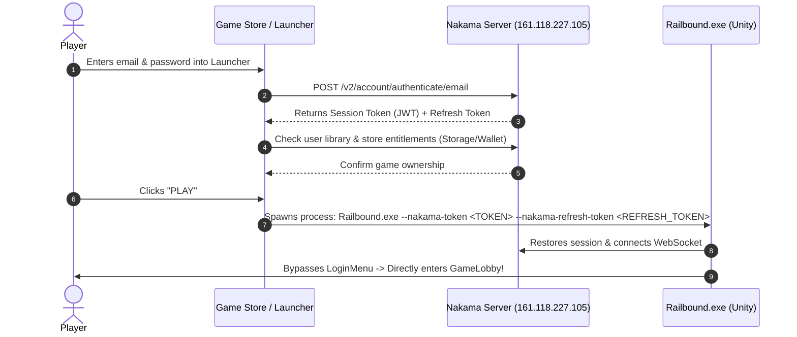

# Game Store & Launcher Authentication Implementation Guide

This document outlines the architecture, server configuration, launcher implementation, and Unity client integration for authenticating **Railbound** through a custom Game Store / Launcher (similar to Steam, Epic Games Launcher, or Riot Client) using **Nakama Server**.

---

## 1. Architecture Overview

In this model, player authentication happens inside the **Game Store / Launcher** rather than on an in-game login screen. When the user launches Railbound from the store, the launcher passes a session token or one-time ticket to the game client, which seamlessly restores the session and enters the lobby.



---

## 2. Nakama Server Parameters

* **Host**: `161.118.227.105`
* **Port**: `7350` (HTTP / REST & WebSocket)
* **SSL / TLS**: `http` (or `https` on port `7359` when TLS certificate is active)
* **Server Key**: `defaultkey`
* **App ID**: `railbound.game`

---

## 3. Launcher / Store Implementations

Choose the technology stack your launcher is built on:

### Option A: C# / .NET (WPF, Avalonia, WinUI)

#### Install Package:
```shell
dotnet add package Nakama
```

#### Launcher Code (`GameStoreManager.cs`):
```csharp
using System;
using System.Diagnostics;
using System.IO;
using System.Threading.Tasks;
using Nakama;

public class GameStoreManager
{
    private readonly IClient _client;
    private ISession _session;

    public GameStoreManager()
    {
        // 1. Initialize Nakama Client
        _client = new Client("http", "161.118.227.105", 7350, "defaultkey");
    }

    /// <summary>
    /// Authenticate player into the store
    /// </summary>
    public async Task<bool> LoginAsync(string email, string password)
    {
        try
        {
            _session = await _client.AuthenticateEmailAsync(email, password);
            Console.WriteLine($"[Store] Logged in as: {_session.Username} (ID: {_session.UserId})");
            return true;
        }
        catch (Exception ex)
        {
            Console.WriteLine($"[Store] Login failed: {ex.Message}");
            return false;
        }
    }

    /// <summary>
    /// Check whether the authenticated user owns Railbound
    /// </summary>
    public async Task<bool> CheckOwnershipAsync()
    {
        if (_session == null) return false;

        try
        {
            // Read "library" collection from Nakama storage
            var result = await _client.ReadStorageObjectsAsync(_session, new[]
            {
                new StorageObjectId { Collection = "library", Key = "railbound", UserId = _session.UserId }
            });

            return result.Objects.Count > 0;
        }
        catch
        {
            // If free-to-play or public access, default to true
            return true;
        }
    }

    /// <summary>
    /// Launches Railbound with the authenticated session handoff
    /// </summary>
    public void LaunchGame(string gameExePath)
    {
        if (_session == null || _session.IsExpired)
        {
            throw new InvalidOperationException("User must be logged in before launching the game.");
        }

        if (!File.Exists(gameExePath))
        {
            throw new FileNotFoundException("Game executable not found.", gameExePath);
        }

        var startInfo = new ProcessStartInfo
        {
            FileName = gameExePath,
            Arguments = $"--nakama-token \"{_session.AuthToken}\" --nakama-refresh-token \"{_session.RefreshToken}\"",
            UseShellExecute = false,
            WorkingDirectory = Path.GetDirectoryName(gameExePath)
        };

        Process.Start(startInfo);
        Console.WriteLine("[Store] Game process launched with session handoff.");
    }
}
```

---

### Option B: Electron / TypeScript (Web / Node.js Desktop)

#### Install Package:
```shell
npm install @heroiclabs/nakama-js
```

#### Launcher Code (`launcherService.ts`):
```typescript
import { Client, Session } from "@heroiclabs/nakama-js";
import { spawn } from "child_process";
import * as path from "path";

export class LauncherService {
  private client: Client;
  private session: Session | null = null;

  constructor() {
    this.client = new Client("defaultkey", "161.118.227.105", "7350", false);
  }

  async login(email: string, pass: string): Promise<boolean> {
    try {
      this.session = await this.client.authenticateEmail(email, pass);
      return true;
    } catch (err) {
      console.error("Login failed:", err);
      return false;
    }
  }

  launchGame(gameExePath: string) {
    if (!this.session) {
      throw new Error("User not authenticated.");
    }

    const args = [
      "--nakama-token", this.session.token,
      "--nakama-refresh-token", this.session.refresh_token
    ];

    const child = spawn(gameExePath, args, {
      detached: true,
      stdio: "ignore",
      cwd: path.dirname(gameExePath)
    });

    child.unref();
  }
}
```

---

## 4. Unity Client Integration (`AuthenticationService.cs`)

When the game launches, `AuthenticationService.cs` checks the command-line arguments. If tokens were provided by the launcher, it restores the session, establishes the socket, and bypasses `LoginMenu` to load `GameLobby` directly.

### Implementation Snippet for `AuthenticationService.cs`:

```csharp
private void Awake()
{
    if (Instance != null && Instance != this)
    {
        Destroy(gameObject);
        return;
    }
    Instance = this;
    DontDestroyOnLoad(gameObject);
    InitClient();

    // Check for launcher command line arguments first
    _ = CheckLaunchArgumentsAndInitAsync();
}

private async Task CheckLaunchArgumentsAndInitAsync()
{
    string[] args = System.Environment.GetCommandLineArgs();
    string launcherToken = null;
    string launcherRefreshToken = null;

    for (int i = 0; i < args.Length; i++)
    {
        if (args[i] == "--nakama-token" && i + 1 < args.Length)
        {
            launcherToken = args[i + 1].Trim('\"');
        }
        else if (args[i] == "--nakama-refresh-token" && i + 1 < args.Length)
        {
            launcherRefreshToken = args[i + 1].Trim('\"');
        }
    }

    // 1. Session passed from Game Store / Launcher
    if (!string.IsNullOrEmpty(launcherToken))
    {
        Debug.Log("[Auth] Detected session token from launcher. Restoring session...");
        try
        {
            InitClient();
            var restored = Nakama.Session.Restore(launcherToken, launcherRefreshToken);

            // If access token expired, refresh with refresh token
            if (restored.IsExpired && !string.IsNullOrEmpty(launcherRefreshToken))
            {
                restored = await _client.SessionRefreshAsync(restored);
            }

            if (!restored.IsExpired)
            {
                _session = restored;
                currentUserId = _session.UserId;
                isAuthenticated = true;

                // Save locally to secure store
                SecureSessionStore.TrySave(_session.AuthToken);

                await EnsureSocketAsync();
                IsAuthenticationReady = true;
                OnLoginSuccess?.Invoke(AuthResult.Success(currentUserId));

                Debug.Log($"[Auth] Logged in via Launcher as {_session.Username} ({_session.UserId})");

                // Auto-load lobby, skipping login menu entirely
                if (autoLoadLobbyOnSuccess && !string.IsNullOrEmpty(lobbySceneName))
                {
                    LoadLobby();
                }
                return;
            }
        }
        catch (Exception ex)
        {
            Debug.LogError($"[Auth] Failed to restore launcher session: {ex.Message}");
        }
    }

    // 2. Fallback: Check local secure store or let player log in via in-game UI
    if (autoRestoreSession)
    {
        await TryRestoreSessionAsync();
    }
    else
    {
        IsAuthenticationReady = true;
    }
}
```

---

## 5. High-Security Option: One-Time Launch Ticket (Steam Pattern)

If you want to avoid passing long-lived JWT tokens inside command-line strings (which can be viewed by other programs in Windows Task Manager / Process Explorer), use the **One-Time Launch Ticket Pattern**:

```
[Launcher] --(1. rpc/get_launch_ticket)--> [Nakama Server] (Generates random 32-char token, caches for 60s)
[Launcher] --(2. Railbound.exe --launch-ticket <TICKET>)--> [Unity Client]
[Unity]    --(3. rpc/claim_launch_ticket)--> [Nakama Server] (Validates & destroys ticket, returns fresh ISession)
```

### Nakama Server RPC (TypeScript / JavaScript Module):

```typescript
// nakama-project/src/launcher_ticket.ts
function rpcGenerateLaunchTicket(ctx: nkruntime.Context, logger: nkruntime.Logger, nk: nkruntime.Nakama, payload: string): string {
    const userId = ctx.userId;
    if (!userId) {
        throw new Error("Unauthorized");
    }

    const ticketId = nk.uuidv4();
    // Save in storage with a 60 second lifetime
    nk.storageWrite([{
        collection: "launch_tickets",
        key: ticketId,
        userId: userId,
        value: { createdAt: Date.now() },
        permissionRead: 0,
        permissionWrite: 0
    }]);

    return JSON.stringify({ ticket: ticketId });
}

function rpcClaimLaunchTicket(ctx: nkruntime.Context, logger: nkruntime.Logger, nk: nkruntime.Nakama, payload: string): string {
    const data = JSON.parse(payload);
    const ticketId = data.ticket;

    // Look up ticket
    const objects = nk.storageRead([{ collection: "launch_tickets", key: ticketId, userId: "" }]);
    if (objects.length === 0) {
        throw new Error("Invalid or expired launch ticket");
    }

    const targetUserId = objects[0].userId;

    // Delete ticket immediately so it can only be redeemed once
    nk.storageDelete([{ collection: "launch_tickets", key: ticketId }]);

    // Issue a fresh session for targetUserId
    const sessionToken = nk.authenticateCustom(targetUserId, undefined, false);
    return JSON.stringify({ token: sessionToken.token });
}
```

---

## 6. Testing the Integration from Command Line

You do not need to wait for the launcher to be completed to test this. You can test session handoff directly using PowerShell or Command Prompt:

1. Obtain a valid Nakama JWT token (from `SecureSessionStore`, postman, or test script).
2. Start the game executable with the argument:
   ```powershell
   .\Railbound.exe --nakama-token "eyJhbGciOiJIUzI1NiIsInR5cCI6IkpXVCJ9..."
   ```
3. Observe the game immediately skip the `LoginMenu` and transition to `GameLobby`.

